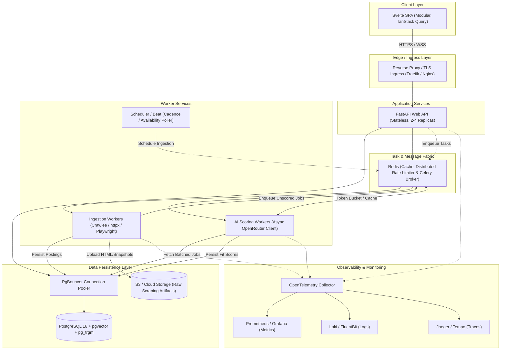

# JevScout Target System Architecture & Modernization Blueprint

**Role:** Principal Systems Architect  
**Scope:** Medium-Scale Production Target (1,000–50,000 active postings; 50–200 concurrent users; continuous ingestion & AI fit scoring)  
**Status:** Architecture Blueprint & Reference Specification  

---

## 1. Executive Summary & Guiding Principles

JevScout is transitioning from a single-user prototype using local JSON persistence, flock locking, and in-memory execution into a resilient, multi-tenant ingestion and personalized job fit classification platform.

To support 1,000–50,000 active postings and 50–200 concurrent users without degraded latency or lost state, the target architecture establishes five core principles:
1. **Durable, Asynchronous Worker Offloading:** Web ingestion and LLM classification are decoupled entirely from the HTTP request/response cycle.
2. **Relational Source of Truth with Specialized Indexes:** Transition from unstructured filesystem JSON and raw JSONB blobs to a normalized PostgreSQL schema with GIN/trigram indexes for search and `pgvector` for semantic match vectors.
3. **Multi-Tiered Caching & Deduplication:** Redis acts as the ephemeral state broker, caching layer, distributed rate limiter, and task queue backend.
4. **Resilient Network & External API Gateways:** Outbound requests (crawling ATS platforms, calling OpenRouter) employ adaptive token-bucket rate limiting, circuit breakers, and exponential backoff with jitter.
5. **Zero-Trust Multi-Tenancy:** Explicit identity boundaries (JWT/OIDC), scoped database queries, and input validation at the edge.

---

## 2. Target System Topology



---

## 3. Technology Stack Specifications

| Domain | Recommended Technology | Justification |
| :--- | :--- | :--- |
| **API Framework** | **FastAPI (Python 3.12, Uvicorn, uvloop)** | High-throughput asynchronous async/await event loop, native Pydantic v2 validation, OpenAPI auto-spec generation. |
| **Task Queue & Orchestration** | **Celery or ARQ (backed by Redis)** | Durable retries, task prioritization, distributed worker pooling, and dead-letter queue (DLQ) support. |
| **Primary Database** | **PostgreSQL 16 + `pgvector` + `pg_trgm`** | Single transactional database covering relational data, GIN full-text search, and vector embeddings for semantic job matching without needing a separate Elasticsearch cluster. |
| **Database Tooling** | **SQLAlchemy 2.0 (Async) + Alembic** | Explicit schema definitions, type-safe queries, connection pooling, and versioned, rollback-capable migrations. |
| **Connection Pooling** | **PgBouncer (Transaction Pooling mode)** | Dampens connection pressure from multiple worker processes and API replicas. |
| **Caching & Rate Limiting** | **Redis 7.2 (Standalone with Persistence or Valkey)** | Sub-millisecond cache for user sessions, parsed search filters, OpenRouter token bucket counters, and task queue broker. |
| **Ingestion Engine** | **Async httpx + Crawlee Python (Playwright for JS-heavy ATS)** | Hybrid approach: fast direct HTTP parsing for standard ATS APIs (Greenhouse/Lever), browser automation only when dynamic hydration is required. |
| **AI Client Layer** | **httpx async client with Tenacity + Token Bucket** | Asynchronous batching, structured JSON outputs with instructor/Pydantic, exponential backoff, and Redis-backed semantic decision caching. |
| **Frontend Framework** | **SvelteKit / Svelte 5 + TanStack Query (Svelte)** | Reactive fine-grained reactivity (Runes), server-state caching, automatic background revalidation, and virtualized list rendering. |
| **Observability** | **OpenTelemetry SDK + Prometheus + Grafana + structlog** | Standardized vendor-neutral instrumentation across HTTP, DB, queue, and external LLM spans. |

---

## 4. Architectural Solutions to Critical Bottlenecks

### 1. Persistence & Concurrency: Normalized Relational Model

Decompose the domain into a 3NF relational schema with targeted JSONB fields for dynamic crawler payloads:

```sql
-- Schema Migration (Alembic)
CREATE TABLE companies (
    id UUID PRIMARY KEY DEFAULT gen_random_uuid(),
    name VARCHAR(255) NOT NULL,
    domain VARCHAR(255) UNIQUE NOT NULL,
    ats_type VARCHAR(50) NOT NULL, -- 'greenhouse', 'lever', 'ashby', etc.
    created_at TIMESTAMPTZ NOT NULL DEFAULT NOW()
);

CREATE TABLE job_postings (
    id UUID PRIMARY KEY DEFAULT gen_random_uuid(),
    company_id UUID NOT NULL REFERENCES companies(id) ON DELETE CASCADE,
    external_id VARCHAR(255) NOT NULL,
    title VARCHAR(500) NOT NULL,
    canonical_url TEXT NOT NULL UNIQUE,
    location VARCHAR(255),
    is_remote BOOLEAN DEFAULT FALSE,
    raw_description TEXT NOT NULL,
    cleaned_description TEXT NOT NULL,
    embedding vector(1536), -- text-embedding-3-small
    search_vector tsvector GENERATED ALWAYS AS (
        to_tsvector('english', title || ' ' || cleaned_description || ' ' || coalesce(location, ''))
    ) STORED,
    salary_min NUMERIC(12, 2),
    salary_max NUMERIC(12, 2),
    currency VARCHAR(10) DEFAULT 'USD',
    status VARCHAR(50) NOT NULL DEFAULT 'ACTIVE', -- 'ACTIVE', 'EXPIRED', 'FILLED'
    first_seen_at TIMESTAMPTZ NOT NULL DEFAULT NOW(),
    last_verified_at TIMESTAMPTZ NOT NULL DEFAULT NOW(),
    raw_metadata JSONB DEFAULT '{}'::jsonb
);

CREATE INDEX idx_job_postings_status_verified ON job_postings (status, last_verified_at);
CREATE INDEX idx_job_postings_search_vector ON job_postings USING GIN (search_vector);
CREATE INDEX idx_job_postings_company_id ON job_postings (company_id);

CREATE TABLE user_profiles (
    id UUID PRIMARY KEY DEFAULT gen_random_uuid(),
    user_id UUID NOT NULL, -- Maps to Auth system
    profile_name VARCHAR(100) NOT NULL,
    target_roles TEXT[] NOT NULL,
    skills TEXT[] NOT NULL,
    criteria_prompt TEXT NOT NULL,
    is_active BOOLEAN DEFAULT TRUE,
    created_at TIMESTAMPTZ NOT NULL DEFAULT NOW()
);

CREATE TABLE job_evaluations (
    id UUID PRIMARY KEY DEFAULT gen_random_uuid(),
    job_id UUID NOT NULL REFERENCES job_postings(id) ON DELETE CASCADE,
    profile_id UUID NOT NULL REFERENCES user_profiles(id) ON DELETE CASCADE,
    decision VARCHAR(20) NOT NULL, -- 'MATCH', 'NO_MATCH', 'UNCERTAIN'
    fit_score INT NOT NULL CHECK (fit_score BETWEEN 0 AND 100),
    reasoning TEXT NOT NULL,
    model_version VARCHAR(50) NOT NULL,
    prompt_hash VARCHAR(64) NOT NULL,
    job_content_hash VARCHAR(64) NOT NULL,
    created_at TIMESTAMPTZ NOT NULL DEFAULT NOW(),
    CONSTRAINT uq_job_profile_hash UNIQUE (job_id, profile_id, prompt_hash)
);
CREATE INDEX idx_evaluations_profile_score ON job_evaluations (profile_id, fit_score DESC);
```

---

### 2. Pipeline Execution: Durable Task Queue & Finite State Machines

Replace in-memory threads with a Celery/ARQ distributed task queue and a persistent state machine stored in PostgreSQL.

- **Pipeline Execution Table:**
  Every crawl or classification run is a record in `pipeline_runs`:
  `id, pipeline_type, status, total_items, processed_items, failed_items, error_log, started_at, completed_at`.
- **Worker Idempotency:**
  Tasks include an `idempotency_key` based on `domain + execution_date`. If a worker terminates abruptly, Celery's `acks_late=True` combined with idempotent database `ON CONFLICT DO UPDATE` ensures safe replay without duplicate jobs.
- **Dead Letter Queue (DLQ):** Failed tasks with exhausted retries are published to a dead-letter exchange/queue for alerting and manual replay.

---

### 3. Paginated, Indexed Data Access: Replacing O(N) In-Memory Scans

All search, filtering, and deduplication are executed by PostgreSQL using GIN indexes and cursor-based pagination:

```python
@router.get("/api/v1/jobs", response_model=JobPageResponse)
async def list_jobs(
    db: AsyncSession = Depends(get_db_session),
    current_user: User = Depends(get_current_user),
    query: Optional[str] = None,
    profile_id: Optional[UUID] = None,
    min_score: Optional[int] = None,
    is_remote: Optional[bool] = None,
    limit: int = Query(50, le=100),
    cursor: Optional[str] = None,
):
    stmt = select(JobPosting, JobEvaluation.fit_score)\
        .outerjoin(JobEvaluation, (JobEvaluation.job_id == JobPosting.id) & (JobEvaluation.profile_id == profile_id))\
        .where(JobPosting.status == 'ACTIVE')

    if query:
        stmt = stmt.where(JobPosting.search_vector.op("@@")(func.websearch_to_tsquery('english', query)))
    if is_remote is not None:
        stmt = stmt.where(JobPosting.is_remote == is_remote)
    if min_score is not None:
        stmt = stmt.where(JobEvaluation.fit_score >= min_score)

    if cursor:
        score_val, id_val = decode_cursor(cursor)
        stmt = stmt.where(
            tuple_(coalesce(JobEvaluation.fit_score, 0), JobPosting.id) < (score_val, id_val)
        )
    
    stmt = stmt.order_by(coalesce(JobEvaluation.fit_score, 0).desc(), JobPosting.id.desc()).limit(limit + 1)
    results = (await db.execute(stmt)).all()
    return paginate_results(results, limit)
```

---

### 4. AI Fit Scoring: Asynchronous Batching, Rate Limiting & Hashing

1. **Content Hash Determinism:**
   Compute `job_hash = SHA256(cleaned_description)` and `profile_hash = SHA256(user_criteria)`. Store evaluation results keyed by `job_hash:profile_hash`. If a company re-posts an identical job description under a new URL, the AI evaluation is instantaneous and cached.
2. **Distributed Token Bucket Limiter:**
   Implemented via Redis Lua script to track both **Requests Per Minute (RPM)** and **Tokens Per Minute (TPM)** across all distributed scoring workers.
3. **Structured Outputs:** Use Instructor with Pydantic schemas (`FitEvaluation(score: int, reasoning: str, match_decision: DecisionEnum)`) to eliminate non-deterministic parsing errors.
4. **Resilient Retry Policy:** Wrap outbound LLM requests with `tenacity`:
   - Exponential backoff: `wait_random_exponential(multiplier=1, max=60)`
   - Retry on `429 Too Many Requests` and `5xx Server Errors`.
   - Circuit breaker fails fast if OpenRouter has an extended outage, putting jobs into a retryable pending queue.

---

### 5. Ingestion Engine: Resilient DNS, Domain Throttling & Delta Crawling

1. **Standardized Async DNS & Connection Pooling:**
   Configure `httpx.AsyncClient` or Crawlee's HTTP client with standard RFC-compliant DNS resolution using an asynchronous resolver (e.g., `aiodns` or standard socket pool). Connection pools are shared per-domain with strict `keepalive` timeouts.
2. **Per-Domain Distributed Rate Limiting:**
   Use Redis-backed Leaky/Token Buckets per target ATS domain:
   - `rate_limit:domain:greenhouse.io` -> 10 req/sec
   - `rate_limit:domain:lever.co` -> 5 req/sec
   - `rate_limit:domain:ashbyhq.com` -> 5 req/sec
3. **Listing Availability Poller:**
   Hourly lightweight `HEAD` or selective `GET` validation worker checking if `canonical_url` returns `404` or `301/302 Redirect`. Update `status = 'EXPIRED'` without re-scraping the full site.
4. **Content Normalization & Deduplication:**
   Strip tracking query parameters (`utm_*`, `ref`, `gh_src`) before URL canonicalization. Extract and clean the core DOM container (`article`, `#content`, `.job-description`) using Readability/BeautifulSoup to ensure consistent content hashing.

---

### 6. Frontend Architecture: Modular Svelte 5 + TanStack Query

- **Server-State Management (TanStack Query for Svelte):**
  Eliminate manual `fetch` calls in `onMount`. Utilize queries with `staleTime: 60_000` and automatic cache invalidation on job status changes.
- **URL-Driven Filter State:**
  All filter parameters (`q`, `remote`, `minScore`, `page`) are synced to URL search parameters. This enables deep linking, browser history navigation, and shareable searches.
- **Virtualized DOM List:**
  Render only visible rows in the viewport using virtual list techniques (`svelte-virtual`), allowing smooth 60fps scrolling even with thousands of jobs in memory.
- **SSE/WebSocket for Pipeline Progress:**
  Instead of polling the API every second, open a lightweight Server-Sent Events (SSE) connection (`/api/v1/pipelines/{id}/events`) for live ingestion progress.

---

### 7. Security, Identity & Multi-Tenancy

1. **Authentication (AuthN) & Token Validation:**
   - Implement OIDC / OAuth2 with JWT tokens.
   - Every request carries `Authorization: Bearer <jwt>`.
   - The API validates the JWT signature, issuer, and expiration date using public JWKS.
2. **Role-Based & Tenant-Scoped Authorization (AuthZ):**
   - Inject the authenticated `UserContext` via FastAPI dependency injection.
   - All queries accessing `user_profiles` or `job_evaluations` MUST filter by `user_id = current_user.id`. Path parameters containing arbitrary usernames are deprecated in favor of `@me` or derived user IDs from the cryptographically verified JWT claim.
3. **API Rate Limiting & Input Sanitization:**
   - Rate limit API requests per IP and authenticated user using `slowapi` or Redis token buckets.
   - Strict Pydantic models validate all payloads with bounds checking on strings and numeric inputs.

---

### 8. Observability, Reliability & Operations

1. **Structured JSON Logging (`structlog`):**
   Emit JSON logs containing standardized correlation contexts: `trace_id`, `job_id`, `profile_id`, `model`, `duration_ms`, `tokens_used`.
2. **Distributed Tracing (OpenTelemetry):**
   Instrument FastAPI, SQLAlchemy, HTTPX, and Celery workers with OpenTelemetry auto-instrumentors. Trace context propagates through Redis task payloads.
3. **Key Prometheus Metrics:**
   - `crawl_postings_discovered_total{domain, status}`
   - `crawl_domain_request_duration_seconds{domain}`
   - `llm_scoring_requests_total{model, status_code}`
   - `llm_token_usage_total{model, type="prompt|completion"}`
   - `queue_lag_seconds{queue_name}`
4. **Graceful Shutdown & Signal Handling:**
   - Uvicorn/FastAPI handles `SIGTERM` by closing listeners and allowing in-flight requests 15 seconds to complete.
   - Celery workers configured with `worker_cancel_long_running_tasks_on_connection_loss` and warm shutdown timeouts (`SIGTERM`) finish the current atomic chunk before acknowledging and exiting.

---

## 5. Phased Implementation Roadmap

| Phase | Duration | Key Milestones |
| :--- | :--- | :--- |
| **Phase 1: Persistence & Core Data Access** | Weeks 1–2 | Deploy PostgreSQL 16; build Alembic migrations; replace `FileRunStore`; implement cursor-paginated `/api/jobs`. |
| **Phase 2: Task Queue & Resilient Ingestion** | Weeks 3–4 | Deploy Redis; configure Celery/ARQ workers; add per-domain rate limiting; implement hourly listing availability poller. |
| **Phase 3: AI Engine & Frontend Decomposition** | Weeks 5–6 | Async OpenRouter client with exponential backoff & content hash caching; modularize Svelte 5 frontend with virtual lists. |
| **Phase 4: Security & Observability** | Weeks 7–8 | Implement JWT bearer auth; add OpenTelemetry tracing & `structlog`; execute load tests for 50k jobs & 200 concurrent users. |
