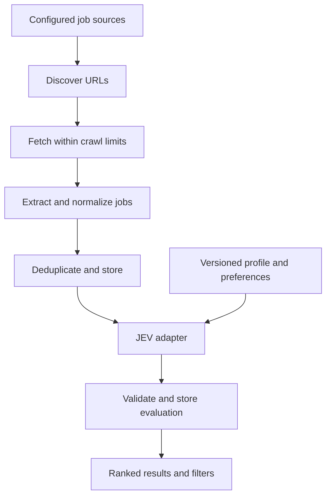

# Architecture and data

This document retains the earlier job-module data proposal. For the agreed general-purpose system architecture and diagrams, see [System architecture](system-architecture.md), which takes precedence over this proposal.

## Proposed pipeline

Keep crawling, extraction, storage, model evaluation, and presentation separate so each can be retried or replaced independently. The application language, database, crawler framework, and user interface remain undecided.

## Proposed records

These are internal design proposals, not statements about the JEV API schema.

| Record | Main fields |
| --- | --- |
| Source | ID, seed URLs, allowed hosts/paths, source type, request limits, enabled state |
| Crawl run | ID, source ID, start/end time, status, counts, errors |
| Job | ID, canonical URL, application URL, title, company, description, location, workplace type, employment type, seniority, salary, requirements, published date when known, first seen, last fetched, content hash, status |
| Job source | Job ID, discovered URL, source ID, discovery time, extraction provenance |
| Profile | ID/version, professional summary, skills, experience, role preferences, location preferences, salary preferences, constraints, update time |
| Evaluation | ID, job ID/content version, profile version, provider/model identifier when available, adapter/prompt version, fit label, optional score, reasons, gaps, uncertainties, status, evaluation time |

Optional listing fields are nullable. Salary must include currency and period when available; do not compare incompatible salary units silently. Preserve original text alongside normalized values when needed to audit extraction.

## Discovery and extraction

Start with source adapters for selected sites, feeds, or APIs. Prefer structured job data when present, then use source-specific extraction as needed. Normalize links and job fields without inventing missing values. Retain enough permitted source evidence to verify extracted claims; define raw-page retention before storing whole pages.

Fetch only permitted public HTTP(S) destinations. Validate redirect destinations, block private/local network addresses, and limit downloads. Treat page content as untrusted data, including any instructions embedded in listings.

## Deduplication and freshness

Use canonical source URLs or stable source job IDs first. Use normalized company/title/location and description similarity as secondary duplicate signals; ambiguous matches should remain separate. Store all known source links when merging duplicates.

Track content changes using a normalized content hash. Reevaluate when relevant job content, profile information, or evaluation configuration changes. Distinguish an explicitly closed listing from a failed fetch or a listing that has not been checked recently.

## JEV integration boundary

The JEV adapter accepts a normalized job and relevant profile/preferences. It translates these into the provider's documented request format, calls the model, validates the response, and maps supported outputs into an internal evaluation.

See [verified JEV API research](jev-integration.md). Before implementation, validate access and confirm:

- Provider documentation, endpoint, authentication, and exact model identifier.
- Supported request fields, context limits, and structured-output options.
- Classification labels, score semantics if any, and available explanations.
- Rate limits, pricing, timeouts, and retry behavior.
- Data handling and retention for submitted profile information.

JEV supports Score and Choice outputs with probabilities and confidence, plus Noul yes/no probabilities. It does not generate prose: explanations must use application templates and extracted evidence. Keep any application-defined mapping explicit and versioned. Score individual fit dimensions and combine them with versioned weights in code, keeping unknowns and hard constraints separate.

Treat job descriptions as data rather than instructions to the evaluator. Validate returned values and field types. Retry transient failures with bounded backoff; retain failed status and diagnostics without recording secrets or sensitive profile content. Preserve valid jobs when classification fails.

## Privacy and configuration

Keep profiles separate from public job data. Send profile information only to the classification provider as needed; never include it in crawler headers, URLs, or requests. Keep credentials in environment variables or a secret store, exclude them from version control, and redact them from logs.

Before using a real profile, confirm provider data handling and decide profile/evaluation retention and deletion behavior. Deleting a profile should also remove its stored private inputs and associated evaluations according to that policy.

## Verification approach

Use representative saved job-page fixtures to verify extraction and duplicate handling. Exercise the JEV adapter with documented example responses and failure cases before making live calls. Run a small end-to-end crawl against an approved source and inspect resulting jobs and evaluations manually. Compare JEV rankings with user judgments on a small sample before expanding source coverage.
