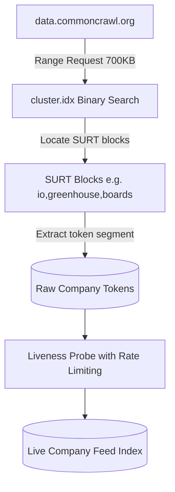

# Browserless Career Feeds and ATS Discovery (India & Global)

Status: Comprehensive research, empirical coverage measurement, and architecture documentation, October 2026.
Branch: `gemini/feature/job-portal`.

---

## 1. Executive Summary & The Discovery Paradigm

Traditional job aggregators (LinkedIn, Indeed, Naukri) rely on scraping and aggressive bot countermeasures. In contrast, modern applicant tracking systems (ATS) publish **public, unauthenticated, structured JSON endpoints** designed specifically for careers pages.

Based on empirical data from the [Open ATS Feed measurement](https://veresk06.github.io/open-ats-feed/):
- **18,164 live companies** and **439,867 live postings** are directly reachable across 6 primary ATS vendors with zero authentication and zero terms-of-service violations.
- Company discovery does not require search engines or crawling: **Common Crawl's URL index (CDX)** is a pre-indexed directory of company board tokens. A targeted binary-search range request against `cluster.idx` on `data.commoncrawl.org` enumerates company slugs across entire crawls for ~700 KB of network transfer per host.

---

## 2. The 6 Permitted & Validated ATS Feed Endpoints

Every provider listed below is verified under RFC 9309 `robots.txt` compliance against both live endpoints and Common Crawl archived history.

| Provider | URL Token Structure | Public Unauthenticated API Endpoint | Verified Liveness Rate | Measured Live Postings | Politeness & Rate Limits |
| :--- | :--- | :--- | :--- | :--- | :--- |
| **Greenhouse** | Path: `boards.greenhouse.io/{token}` | `GET https://boards-api.greenhouse.io/v1/boards/{token}/jobs?content=true` | 56.5% (5,971 live) | 196,407 | Allowed. Live robots disallows `/embed/`, does not touch `/v1/boards/`. |
| **Ashby** | Path: `jobs.ashbyhq.com/{token}` | `GET https://api.ashbyhq.com/posting-api/job-board/{token}?includeCompensation=true` | 72.7% (3,413 live) | 59,609 | Allowed. Live endpoint returns 401 on `/robots.txt` (never served). |
| **Lever** | Path: `jobs.lever.co/{token}` | `GET https://api.lever.co/v0/postings/{token}?mode=json` | 37.5% (1,925 live) | 69,565 | **Strict Crawl-delay: 1 req/sec**. `api.lever.co` robots allows `/`. |
| **Breezy HR** | Subdomain: `{token}.breezy.hr` | `GET https://{token}.breezy.hr/json` | 43.3% (2,077 live) | 41,119 | Allowed. Disallows `/css`, `/fonts`, `/javascripts`. |
| **Recruitee** | Subdomain: `{token}.recruitee.com` | `GET https://{token}.recruitee.com/api/offers/` | 65.1% (2,444 live) | 39,628 | Allowed. Disallows `/v/`. |
| **Teamtailor** | Subdomain: `{token}.teamtailor.com` | `GET https://{token}.teamtailor.com/jobs.json` | 66.3% (2,334 live) | 33,539 | Allowed. Disallows `/app/`, `/messages/`. |

---

## 3. Explicitly Refused Vendors (Governance Boundary)

In accordance with JevScout's strict operational permissions, the following vendors are **explicitly excluded**:

1. **SmartRecruiters**:
   - `api.smartrecruiters.com/robots.txt` explicitly serves `Disallow: /` to User-Agent `*`, with only `LinkedInBot` scoped to `/v1/companies/`.
   - *Policy*: Since JevScout is not LinkedInBot, automated access violates vendor declaration. **Refused**.
2. **Personio**:
   - Tenant robots.txt historically and structurally disallows `/xml` (the public feed path). Live host returns 404 on robots.txt due to recent migration, but archived policy disallows. **Refused**.
3. **Workable**:
   - While technically accessible, Workable aggressively rate-limits and throttles unauthenticated requests under concurrent load to uselessness. **Refused**.
4. **Naukri / Foundit / Cutshort**:
   - Guarded behind Cloudflare/Akamai bot management; lack public browserless APIs. **Refused**.

---

## 4. Token Discovery Architecture via Common Crawl S3

Instead of scraping search engines to find which employers use Greenhouse, Ashby, or Lever, JevScout implements **CDX Index Harvesting**:

### 4.1 Token Extraction Rules
- **Path-based hosts**:
  - `io,greenhouse,boards)/{token}` -> token is segment 1.
  - `co,lever,jobs)/{token}` -> token is segment 1.
  - `com,ashbyhq,jobs)/{token}` -> token is segment 1.
- **Subdomain-based hosts**:
  - `hr,breezy,{token})/` -> token is the subdomain segment.
  - `com,recruitee,{token})/` -> token is the subdomain segment.
  - `com,teamtailor,{token})/` -> token is the subdomain segment.

### 4.2 Lever Robot Exclusion Historical Fix
`jobs.lever.co/robots.txt` contains `User-agent: CCBot / Disallow: /`, so recent Common Crawl crawls contain only 62 records (all robots.txt itself). However, older Common Crawl indices (2024–2025) were crawled before this ban and hold thousands of valid board URLs. Sweeping prior crawl archives recovers 4,960+ Lever candidate tokens ethically, and liveness probes run against `api.lever.co` at 1 req/sec.

---

## 5. Strict India Location Filtering & Quality Rules

### 5.1 Geographic Matching Policy
To guarantee Indian tech candidates only receive relevant jobs:
- **Direct Indian Locations**:
  - Cities: Bengaluru/Bangalore, Hyderabad, Pune, Mumbai, Gurgaon/Gurugram, Noida, Delhi NCR, Chennai, Kochi, Kolkata, Ahmedabad, Chandigarh, Jaipur, Indore.
  - Country match: `"India"`, `", IN"`, `"country: in"`.
- **India-Eligible Remote**:
  - Explicit: `"Remote - India"`, `"India - Remote"`, `"Remote (India)"`.
  - Worldwide: `"Worldwide Remote"`, `"Anywhere in the world"`, `"Remote - Global"`.
- **Strictly Excluded**:
  - Foreign countries: US, UK, Germany, Canada, Singapore, Australia, etc.
  - Region-locked remotes: `"Remote - US Only"`, `"Remote - North America"`, `"Remote - EMEA"`, `"Remote - LatAm"`.

### 5.2 Quality Guards Against Description Noise & False Positives
Empirical findings demonstrate three critical parsing failure modes that JevScout guards against:

1. **Department Explosion (>25 threshold)**:
   - When a company board exposes more than 25 distinct departments (e.g. healthcare or field staffing), the department field is a local branch or sub-team code (e.g. `"Regional Visits (BV) - 94"`), not an organizational function.
   - *Guard*: Suppress department grouping when count exceeds 25.
2. **Industry Acronym Collisions**:
   - Non-tech domains share acronyms with software engineering: e.g. `dbt` (Dialectical Behavior Therapy in clinical health vs. data build tool in analytics), `PHP` (Partial Hospitalization Program vs. scripting language).
   - *Guard*: Ambiguous tech keywords must only match when the job title, team, or department qualifies as technical.
3. **Markup & CDN Boilerplate Stripping**:
   - Company descriptions frequently embed CDN script URLs (e.g., `cdn2.hubspot.net`, `static.xx.fbcdn.net/images/emoji.php/...`) which trigger false positives for tech stacks like `.NET` or `PHP`.
   - *Guard*: Strip URLs, emails, and HTML tags before keyword or stack evaluation.
