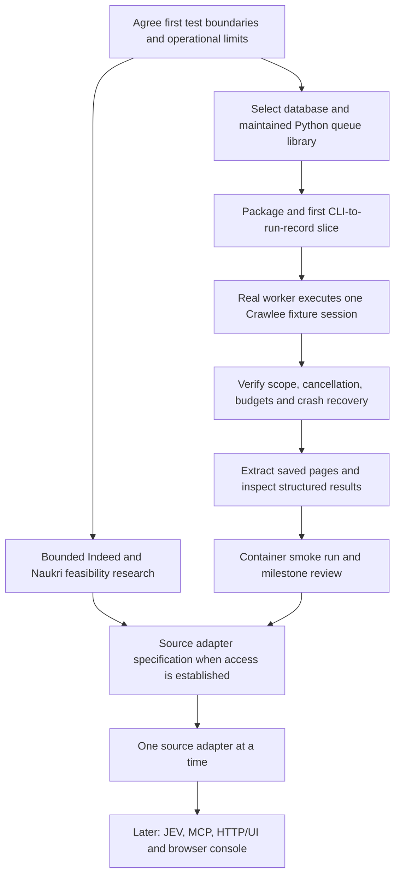

# Execution plan

Status: proposed execution plan, awaiting agreement on test boundaries and remaining infrastructure choices. Planning only; no application code or tests have been written.

## Filesystem-first execution update

The user accepted proceeding with delegated implementation and selected ordinary filesystem storage for current hardware constraints. PostgreSQL is deferred, not required to start. The earlier database-first ordering below is a future target, not the current prerequisite.

First deliver a zero-runtime-dependency Python CLI and storage adapter that validates, creates, persists, and inspects pending run requests. Test those public submission/query and artifact boundaries. No request is executed merely by saving it. Use one local execution process initially and atomic file replacement; no custom distributed file queue or multiwriter promise. Next add a real bounded Crawlee HTTP session with verified destination/redirect scope handling and saved evidence, then extraction. Adopt a maintained database-backed queue before promising multiple application workers or background recovery.

Each delegated implementation task owns specific files and writes `docs/changes/<task>.md`. The coordinator reviews code/checks, updates `CHANGELOG.md` and `HANDOFF.md`, and commits every verified usable slice. Do not represent partial milestones as completed collection.

## Objective and boundaries

Deliver the first collection milestone: CLI submission → authorized, bounded run → Crawlee session → saved evidence → structured extraction → CLI inspection. Use Python and Crawlee for Python. Preserve the modular architecture in [System architecture](system-architecture.md) and [Complete overview](system-overview.md).

The application owns run authorization, application tasks, artifacts, global limits, and results. Crawlee owns URL scheduling, duplicate filtering, browser lifecycle, and bounded request retries inside a crawl session. Do not implement another URL scheduler or copy crawler internals.

Indeed and Naukri remain target sources, not verified integrations. Source feasibility is a separate workstream. A controlled fixture site keeps core development independent of external access, account state, and layout changes. Live source checks are explicit manual checks, not a dependency of ordinary tests.

## Execution flow and gates

Implementation is sequential across shared contracts. Within each slice: agree observable behavior → one failing test → minimal implementation → targeted checks → review → commit. Do not write an entire test suite against imagined interfaces, or delegate all tests separately from all implementation.

## 0. Resolve small decisions before implementation

- Confirm the proposed test boundaries below, as required by the installed TDD skill.
- Select the database product and Python queue library against transactional submission, bounded retries, concurrent worker claiming, crash recovery, cancellation integration, maintenance, and license criteria. PostgreSQL remains the leading proposal. Use a maintained queue; no custom queue engine or temporary bespoke scheduler to throw away later.
- Agree the first operational semantics: approval mode, run scope, budget units, cancellation, and what a completed/partial/failed run means. Keep status names and interfaces small.
- Pin compatible Python/Crawlee/Playwright versions after checking their current support. Choose minimal packaging, lint/type checks, and pytest-based tooling; do not introduce a large framework for a CLI prototype.

Deliverable: a short decision update and approved first-slice inputs/outputs. No schema-heavy platform design required.

## 1. Submit and inspect one durable run

Create the Python package and the smallest core operations for submitting a structured request and inspecting the resulting run. Add the CLI as an adapter, not the location for business logic. Persist the authorized module/source configuration, scope, limits, selected stages, and version identifiers. Use the selected persistence/queue system from the start.

Include a narrow submission idempotency rule so a repeated client request does not accidentally duplicate work. Credentials and browser-profile contents are referenced, never embedded in run payloads.

Exit: a valid proposal becomes a retrievable run with pending work; invalid or unauthorized inputs do not enqueue execution. CLI returns a run ID. Redacted logs correlate submission with that ID.

## 2. Execute a real Crawlee session against controlled pages

Start a bounded worker explicitly. It claims a crawl-session task and calls the Crawlee adapter. Initially use HTTP pages from a controlled fixture site containing links, pagination, duplicates, failures, and out-of-scope destinations.

Add only the engine operations required by this slice, such as session execution, progress reporting, and cancellation. Public contracts carry application-owned data, not Crawlee classes. A source handler supplies seeds/navigation and emits page outcomes and artifact references. Write saved outputs before marking their task handoff complete; make partial-write recovery explicit.

Exit: an approved session produces individually inspectable page outcomes and saved evidence. In-scope links are followed, out-of-scope discoveries become candidates, and queued crawl jobs do not spawn unrestricted processes. One worker is enough initially.

## 3. Prove control and recovery before expanding coverage

Exercise a slow page, transient failure, redirect outside scope, exhausted budget, cancellation, and worker termination. Keep Crawlee request retries separate from outer session retries with one documented accounting policy. Record attempts and preserve partial outputs.

Demonstrate two worker processes sharing the application queue without executing the same leased session concurrently. Coordinate global allocations across sessions instead of multiplying per-crawler concurrency settings. Specify what is counted: target-page requests, retries/redirects, browser subrequests, and provider usage are not interchangeable units. Do not advertise a strict network-request cap using only a framework page limit.

Give engine checkpoint directories isolated durable ownership. Reject or fence writes from stale task owners after lease loss; do not rely on a lease alone for exactly-once external effects. Test recovery or safely bounded replay, including harmless deduplication of persisted outputs. Profile migration between engines is outside scope.

Exit: interruption/cancellation cannot silently report success, exceed the defined resource policy, or corrupt saved output. Recovery behavior and any bounded in-flight work are documented with evidence.

## 4. Extract saved evidence and inspect results

Implement source-specific pure parsing over saved fixture HTML, with a small versioned item schema and source provenance. Queue downstream extraction by artifact reference; do not send whole pages through queue messages. Validate fields and preserve unknowns rather than inventing values.

Expose status, partial results, errors, extracted records, and artifact references through the core/CLI. Support rerunning extraction from a compatible saved artifact without recrawling. A new extraction result/version must not silently erase its provenance.

Exit: one end-to-end CLI run yields inspectable structured records, and an extraction retry/rerun uses saved input. No JEV or live résumé data is needed.

## 5. Make the first milestone reproducible in containers

Build a minimal application image and setup for the selected database, a fixed worker, and persistent artifact storage. The same package can expose CLI and worker entry points without splitting the codebase into services. Run browser work as an appropriate non-root user with required sandbox support when browser capability is added.

Run a small container smoke scenario: submit fixture work, inspect results, restart relevant containers, and confirm retained state. Document commands, configuration, logging/debug mode, and volume ownership. Do not introduce a broker, cluster manager, or one service per module merely to match a diagram.

Exit: another local setup can reproduce collection and extraction with persistent state and explicit resource limits.

## 6. Add target-source adapters in bounded steps

Research Indeed and Naukri independently using primary documentation and representative permitted access. Produce a concise supported/unsupported/unknown matrix for discovery, listing access, authentication, and extraction. Do not promise coverage based on an authenticated browser opening a page.

Implement one verified source path at a time through supported Crawlee hooks. Keep source navigation separate from parsing wherever practical. Reuse permitted saved samples as fixtures and confirm extraction against independently specified expected fields.

For supported authenticated sources, add manual headful login, protected profile persistence, exclusive profile ownership, and explicit reauthentication on expiry. Browser profile state is distinct from crawl checkpoints. Begin with local browser interaction; evaluate noVNC only when container-only login is needed. Avoid concurrent automation while the user owns browser control.

Exit: a documented source path yields real inspectable records, or the source is transparently marked unsupported/pending. Core completion does not depend on both sites becoming available.

## Later increments

Add JEV on saved items, then MCP exposure, HTTP/control UI, optional browser console, search discovery, and additional source modules as separately scoped slices. Shared core contracts and provenance should make these incremental changes. JEV integration needs a synthetic-input API smoke test and an agreed rubric before real profile submission.

## Proposed test boundaries: approval required before tests

Tests observe public behavior with real owned modules. Prefer the selected test database and a controlled HTTP/browser fixture over mocks of our internal collaborators. Mock external providers only where appropriate. Fixture-only loopback access must be an explicit test configuration, not a relaxation of production destination checks.

| Boundary | What it catches | What it does not establish |
| --- | --- | --- |
| CLI and core submission/query | Invalid scope/limits, authorization errors, duplicate submissions, durable inspectable run configuration | Real browser behavior or provider access |
| Worker and application queue integration | Claiming, lifecycle, retry/recovery, cancellation and stale-owner behavior through application operations | General database correctness or every production failure mode |
| Crawlee adapter against fixture HTTP/browser sources | Real traversal, out-of-scope redirects/links, saved evidence, defined resource limits and cancellation behavior | Indeed/Naukri access, arbitrary bot protection, or universal login support |
| Saved artifact to parser output | Known fields, missing/malformed data, schema compatibility, and provenance | Live source availability or every future layout |
| End-to-end CLI inspect/rerun | Broken stage handoffs, partial results, persisted output, extraction reruns without recrawl | Full UI/MCP behavior or broad live-site coverage |

Use one public CLI smoke scenario; avoid duplicating every core behavior in command-line tests. Browser and restart tests run when their slice introduces that behavior. No coverage percentage target or tests of constants/private methods. Run the relevant tests plus required lint/type checks once per meaningful change, broaden only when failures or risk justify it.

## Delegation and cost controls

One integrator owns architecture, public contracts, cross-module changes, final review, and Git operations. Delegation is optional; do not create an agent for work cheaper to do directly.

| Work | Default assignment | Boundary |
| --- | --- | --- |
| Documentation/fixture inventory, command execution, link checks | Luna | Explicit files/commands and compact result; no new design decisions |
| One approved parser or CLI slice with its behavior test | Luna when complexity fits | Agreed contract, exclusive file ownership, one slice; report failures instead of expanding scope |
| Queue/crash-recovery or difficult engine lifecycle investigation | Integrator; Astra only when justified | One concrete unresolved problem, bounded output; no open-ended rewrite |
| Source-access or library comparison | One read-only researcher | Named sources/questions and cited findings; no browsing/crawling accounts or installing extras |
| Independent review | Short Luna review first | Review diff against accepted behavior; no unrelated edits |

Luna is the default delegated model. Astra is an escalation option, not presumed cheaper; actual pricing is not assumed. Keep at most two child agents active, and use one by default. Do not let children spawn agents, push commits, install unrelated dependencies, access accounts, or change shared contracts without returning to the integrator.

Every assignment names the goal, allowed files, public contract, checks, completion condition, and stop condition. Workers stop on missing decisions, scope expansion, or persistent failure; they return evidence rather than running indefinitely. Research can run beside implementation; dependent module implementation cannot run ahead of unsettled contracts. Test writing and implementation stay in the same small red/green slice, with independent review afterward.

Use minimal context, compact findings, targeted file reads, and no repeated full-suite runs without a reason. Avoid concurrent edits to the same files. Integrate and verify each slice before assigning dependent work. Commit coherent slices; publish when requested or within an explicitly agreed publishing workflow.

## Completion evidence

For each slice report changed behavior, exact checks performed, result, and limitations. The first milestone is done when a reproducible CLI/container run collects controlled pages through real Crawlee, retains evidence, extracts records, exposes partial/final status, and demonstrates the agreed retry/cancellation/restart behavior. UI, JEV, and successful Indeed/Naukri automation are not silently included in that milestone.
