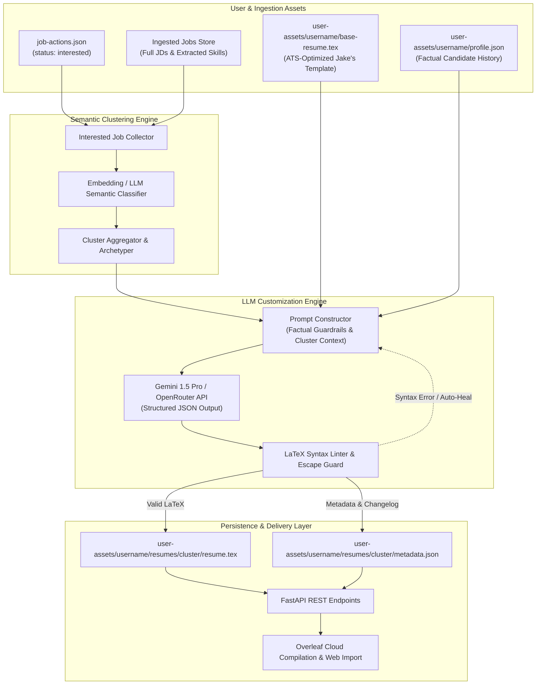
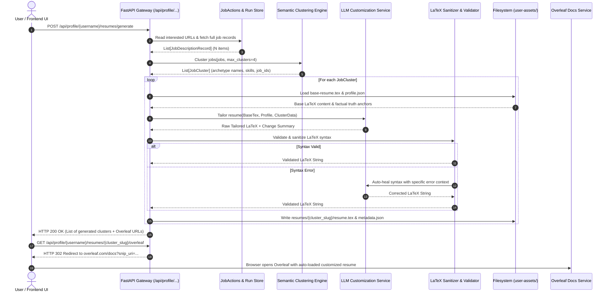
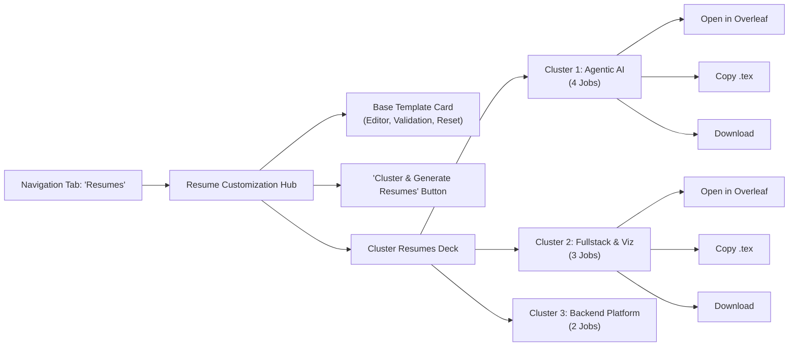

# JevScout Resume Customization & Job Clustering Engine: Technical Implementation Plan

**Target System:** JevScout Core Platform  
**Component:** Semantic Resume Tailoring, Job Clustering & Overleaf Export Pipeline  
**Document Type:** Production-Grade Technical Architecture & Implementation Plan  
**Target Path:** `jevscout/docs/resume-customization-plan.md`  
**Status:** Approved for Implementation  

---

## 1. Executive Summary & Architectural Rationale

### 1.1 The Challenge: Combinatorial Overhead vs. Generic Resumes
In competitive technical hiring, generic resumes achieve significantly lower interview callback rates than resumes tailored to specific skill profiles. However, generating an individual, bespoke resume for every single job posting (e.g., 50–100 applications) creates two critical problems:
1. **Combinatorial Cognitive & Storage Overhead:** Managing dozens of individual PDF/LaTeX variants creates unmaintainable tracking clutter and high LLM API operational costs.
2. **Quality Degradation & Disconnected Personas:** Extreme per-job tailoring leads to disjointed resumes that risk drifting away from the candidate's core narrative.

### 1.2 The Solution: Semantic Archetype Clustering + ATS-Compliant LaTeX Engine
JevScout solves this by introducing a **Semantic Cluster-Based Tailoring Engine**:
* **Semantic Job Clustering:** Instead of $N$ resumes for $N$ jobs, the engine groups a user's `"interested"` jobs into 2–4 coherent **Archetype Clusters** (e.g., *"Agentic AI & LLM Systems"*, *"Fullstack & Frontend Data Viz"*, *"Backend & Data Platform"*).
* **Factual-Truth-Bound LLM Customization:** For each cluster, a dedicated LLM prompt takes the candidate's base LaTeX resume and the aggregated requirements of the cluster to dynamically reorder skills, sharpen professional summaries, and prioritize the most impactful bullet points—without ever fabricating achievements, dates, companies, or degrees.
* **Deterministic LaTeX Syntax Guardrails:** An automated linting and escaping pipeline ensures every generated resume compiles cleanly with `pdflatex` on Overleaf without syntax breaks.
* **Seamless Overleaf & ATS Integration:** Resumes are persisted with complete cluster metadata, providing one-click Overleaf direct-import web links (`https://www.overleaf.com/docs?snip_uri=...`), clipboard copy, and direct `.tex` export.

---

## 2. End-to-End System Architecture & Data Flow

### 2.1 System Topology
The resume customization subsystem sits at the intersection of JevScout's existing User Asset Storage, Run Store / Ingestion Pipeline, and the External LLM API Gateway.



### 2.2 Component Interaction Sequence



---

## 3. Target Persona & Provided Overleaf LaTeX Template Specification

### 3.1 Design Philosophy: RenderCV / Charter Overleaf Template
The base template is the candidate's authentic Overleaf format provided in `user-assets/abhijeet/files/overleaf-format.tex` (synced to `user-assets/<username>/base-resume.tex` and `user-assets/<username>/files/overleaf-format.tex`).

Key architectural attributes of this template:
1. **Typography & Styling:** Uses `charter` font with `T1` fontenc, clean Section borders (`\titleformat`), and custom color definitions (`\definecolor{myblue}{RGB}{0, 0, 150}`).
2. **Modular Environments:** Built with structured RenderCV environments:
   - `\begin{twocolentry}{<date>}{<title>}\end{twocolentry}` for role titles and timeframes using `paracol`.
   - `\begin{onecolentry}\begin{highlights}\item ...\end{highlights}\end{onecolentry}` for bulleted experience achievements.
   - `\begin{highlightsforbulletentries}\item ...\end{highlightsforbulletentries}` for categorised technical skills.
3. **Hyperlinked Provenance:** Contains direct, verifiable links to the candidate's personal portfolio (`https://silicon-hawk.github.io/React-Personal-Website/`), GitHub, LinkedIn, and Drive verification credentials for certifications.
4. **ATS & Overleaf Compatibility:** Compiles cleanly with `pdflatex` using standard CTAN packages (`geometry`, `titlesec`, `tabularx`, `xcolor`, `enumitem`, `fontawesome5`, `paracol`, `hyperref`).

### 3.2 Candidate Profile Grounding (Abhijeet A S)
Grounding is derived directly from the provided template and verified against `user-assets/resume-extracted.txt`:
* **Name & Links:** Abhijeet A S, Hyderabad, India | `[email removed]` | `[number removed]` | `linkedin: abhijeet-a-s` | `github: silicon-hawk`.
* **Current Employer:** Aganitha Cognitive Solutions (Hyderabad, India) — Jr Agentic AI Developer I (Aug 2025 -- Present).
  - MCP agent skills, agentic toolkits, Claude Code.
  - GWAS genomic visualization platform with sub-second rendering and API caching.
  - Healthcare analytics Next.js data-visualization platform.
* **Previous Roles:**
  - Full Stack Web Developer Intern, Aganitha Cognitive Solutions (Feb 2025 -- Aug 2025): Next.js/NextAuth OAuth/LDAP/OTP starter, DBTips backend APIs and Docker.
  - Front End Developer Intern, Clikin Tech (Jul 2024 -- Sep 2024): Responsive client web apps with React.js and Vue.js.
* **Education & Certifications:** 
  - Vellore Institute of Technology (B.Tech CSE, 2021–2025, CGPA: 8.03/10).
  - AWS Certified Cloud Practitioner (2024, with drive link).
  - Google The Bits and Bytes of Computer Networking (2023, with drive link).

### 3.3 Concrete Base Template (`user-assets/<username>/base-resume.tex`)
This is the exact provided template stored in `user-assets/abhijeet/files/overleaf-format.tex` and `user-assets/abhi/base-resume.tex`:

```latex
\documentclass[10pt, letterpaper]{article}

% Packages:
\usepackage[
    ignoreheadfoot,
    top=1 cm,
    bottom=1 cm,
    left=2 cm,
    right=2 cm,
    footskip=1.0 cm,
]{geometry}
\usepackage{titlesec}
\usepackage{tabularx}
\usepackage{array}
\usepackage[dvipsnames]{xcolor}
\definecolor{primaryColor}{RGB}{0, 0, 0}
\usepackage{enumitem}
\usepackage{fontawesome5}
\usepackage{amsmath}
\usepackage[
    pdftitle={Abhijeet A S CV},
    pdfauthor={Abhijeet A S},
    pdfcreator={LaTeX with RenderCV},
    colorlinks=true,
    urlcolor=primaryColor
]{hyperref}
\usepackage[pscoord]{eso-pic}
\usepackage{calc}
\usepackage{bookmark}
\usepackage{lastpage}
\usepackage{changepage}
\usepackage{paracol}
\usepackage{ifthen}
\usepackage{needspace}
\usepackage{iftex}
\definecolor{myblue}{RGB}{0, 0, 150}
\hypersetup{
    colorlinks=true,
    linkcolor=myblue,
    urlcolor=myblue
}
\ifPDFTeX
    \input{glyphtounicode}
    \pdfgentounicode=1
    \usepackage[T1]{fontenc}
    \usepackage[utf8]{inputenc}
    \usepackage{lmodern}
\fi

\usepackage{charter}

% Some settings:
\raggedright
\AtBeginEnvironment{adjustwidth}{\partopsep0pt}
\pagestyle{empty}
\setcounter{secnumdepth}{0}
\setlength{\parindent}{0pt}
\setlength{\topskip}{0pt}
\setlength{\columnsep}{0.15cm}
\pagenumbering{gobble}

\titleformat{\section}{\needspace{4\baselineskip}\bfseries\large}{}{0pt}{}[\vspace{1pt}\titlerule]

\titlespacing{\section}{
    -1pt
}{
    0.3 cm
}{
    0.2 cm
}

\renewcommand\labelitemi{$\vcenter{\hbox{\small$\bullet$}}$}
\newenvironment{highlights}{
    \begin{itemize}[
        topsep=0.10 cm,
        parsep=0.10 cm,
        partopsep=0pt,
        itemsep=0pt,
        leftmargin=0 cm + 10pt
    ]
}{
    \end{itemize}
}

\newenvironment{highlightsforbulletentries}{
    \begin{itemize}[
        topsep=0.10 cm,
        parsep=0.10 cm,
        partopsep=0pt,
        itemsep=0pt,
        leftmargin=10pt
    ]
}{
    \end{itemize}
}

\newenvironment{onecolentry}{
    \begin{adjustwidth}{
        0 cm + 0.00001 cm
    }{
        0 cm + 0.00001 cm
    }
}{
    \end{adjustwidth}
}

\newenvironment{twocolentry}[2][]{
    \onecolentry
    \def\secondColumn{#2}
    \setcolumnwidth{\fill, 6 cm}
    \begin{paracol}{2}
}{
    \switchcolumn \raggedleft \secondColumn
    \end{paracol}
    \endonecolentry
}

\newenvironment{threecolentry}[3][]{
    \onecolentry
    \def\thirdColumn{#3}
    \setcolumnwidth{, \fill, 4.5 cm}
    \begin{paracol}{3}
    {\raggedright #2} \switchcolumn
}{
    \switchcolumn \raggedleft \thirdColumn
    \end{paracol}
    \endonecolentry
}

\newenvironment{header}{
    \setlength{\topsep}{0pt}\par\kern\topsep\centering\linespread{1.5}
}{
    \par\kern\topsep
}

\let\hrefWithoutArrow\href

\begin{document}
    \newcommand{\AND}{\unskip
        \cleaders\copy\ANDbox\hskip\wd\ANDbox
        \ignorespaces
    }
    \newsavebox\ANDbox
    \sbox\ANDbox{$|$}

    \begin{header}
        \fontsize{25 pt}{25 pt}\selectfont \href{https://silicon-hawk.github.io/React-Personal-Website/}{Abhijeet A S}

        \vspace{3 pt}

        \normalsize
        \mbox{Hyderabad, India}%
        \kern 5.0 pt%
        \AND%
        \kern 5.0 pt%
        \mbox{\hrefWithoutArrow{mailto:[email removed]}{[email removed]}}%
        \kern 5.0 pt%
        \AND%
        \kern 5.0 pt%
        \mbox{\hrefWithoutArrow{tel:[number removed]}{[number removed]}}%
        \kern 5.0 pt%
        \AND%
        \kern 5.0 pt%
        \mbox{\hrefWithoutArrow{https://www.linkedin.com/in/abhijeet-a-s/}{linkedin: abhijeet-a-s}}%
        \kern 5.0 pt%
        \AND%
        \kern 5.0 pt%
        \mbox{\hrefWithoutArrow{https://github.com/silicon-hawk}{github: silicon-hawk}}%
    \end{header}

    \vspace{5 pt - 0.3 cm}

\section{Summary}

Full-stack and agentic AI developer at Aganitha who ships research data platforms for biopharma R\&D teams, from UI and APIs to Docker deployment. Led frontend development of a GWAS visualization platform for large genomic datasets, and now builds agent skills that let AI agents operate such platforms. Works directly with domain teams to turn their needs into working software. AWS Certified Cloud Practitioner; 300+ LeetCode problems solved.

\section{Experience}

\begin{twocolentry}{
    August 2025 – Present
}
    \textbf{Jr Agentic AI Developer I}, Aganitha Cognitive Solutions -- Hyderabad
\end{twocolentry}

\vspace{0.10 cm}
\begin{onecolentry}
    \begin{highlights}
        \item \textbf{Agent skills and tooling:} Creating agent skills for an agentic toolkit interface using MCP, agentic workflows and Claude Code, so AI agents can operate research data platforms.
        \item \textbf{GWAS visualization platform:} Led frontend development, optimizing rendering and API caching so large genomic datasets stay responsive. Deployed the frontend with Docker and integrated AI-agent workflows via MDX.
        \item \textbf{Healthcare analytics platform:} Building a scalable Next.js data-visualization platform and designed reusable libraries for filtering and standardized data access, focused on performance and UI consistency.
        \item \textbf{Domain collaboration:} Work with domain teams to translate biopharma R\&D requirements into production tools, owning delivery across UI, backend integration and deployment.
    \end{highlights}
\end{onecolentry}

\vspace{0.10 cm}

\begin{twocolentry}{
    \mbox{Feb 2025 – Aug 2025}
}
    \textbf{Full Stack Web Developer Intern}, Aganitha Cognitive Solutions -- Hyderabad
\end{twocolentry}

\vspace{0.10 cm}
\begin{onecolentry}
    \begin{highlights}
        \item Built a reusable starter template with Next.js and NextAuth for company projects, preconfigured with Google, GitHub, LinkedIn and LDAP sign-in plus a custom email OTP system with domain-based filtering.
        \item Developed backend APIs and frontend features for DBTips and other production biopharma R\&D tools (Node.js, PostgreSQL, Docker), contributing end to end across UI, integration and deployment.
    \end{highlights}
\end{onecolentry}

\vspace{0.10 cm}

\begin{twocolentry}{
    July – September 2024
}
    \textbf{Front End Developer Intern}, Clikin Tech -- Remote
\end{twocolentry}

\vspace{0.10 cm}
\begin{onecolentry}
    \begin{highlights}
        \item Built and customized client websites with React.js, Vue.js and HTML/CSS/JS, working to client requirements and company standards.
    \end{highlights}
\end{onecolentry}

\section{Skills}

\begin{onecolentry}
    \begin{highlightsforbulletentries}
        \item \textbf{Frontend:} Next.js, React.js, TypeScript, JavaScript, HTML5, CSS3, MDX, rendering performance optimization
        \item \textbf{Backend \& Data:} Python, Node.js, FastAPI, REST APIs and API caching, PostgreSQL, NextAuth (OAuth, LDAP, Email OTP), data pipelines
        \item \textbf{Agentic AI:} Agent skills and tools, agentic workflows, MCP, AI-agent integration in web apps, Claude Code, Codex, Cursor
        \item \textbf{Cloud \& DevOps:} Docker, AWS, Azure, self-hosted Linux servers, Git, GitHub, Bitbucket, Jira
        \item \textbf{Other:} C++, DSA. Teamwork, communication, adaptability. Languages: English, Hindi, Malayalam
    \end{highlightsforbulletentries}
\end{onecolentry}

\section{Education}

\begin{twocolentry}{
    2021 – 2025
}
    \textbf{Vellore Institute of Technology}, B.Tech in Computer Science and Engineering
\end{twocolentry}

\begin{onecolentry}
    \begin{highlights}
        \item CGPA: 8.03 / 10
    \end{highlights}
\end{onecolentry}

\section{Certifications}

\begin{twocolentry}{
    2024
}
    \textbf{AWS Certified Cloud Practitioner}, \href{https://drive.google.com/file/d/1EqlGA8slLiJNnxdHW3rSLVk9l9M2y8zE/view?usp=drive_link}{Amazon Web Services}
\end{twocolentry}

\vspace{0.10 cm}

\begin{twocolentry}{
    2023
}
    \textbf{The Bits and Bytes of Computer Networking}, \href{https://drive.google.com/file/d/1SsoQEKB6mD12hnl6mj-w5C7zOGfm-TZC/view?usp=sharing}{Google, Coursera}
\end{twocolentry}

\end{document}
```

---

## 4. Interested Jobs Discovery & Semantic Clustering Engine

### 4.1 Discovery and Enrichment Pipeline
1. **Extraction of Target Jobs:** The pipeline queries `user-assets/<username>/job-actions.json` and filters for all entries where `status == "interested"`.
2. **Metadata Enrichment:** For each interested URL, the engine resolves the job payload from JevScout's run store (`FileRunStore` or PostgreSQL `jobs` table):
   * Title, Company, Location, Employment Type.
   * Full job description text, primary requirements, and extracted tech stack keywords.

### 4.2 Semantic Clustering Algorithm
To handle varying batch sizes ($N$ interested jobs), JevScout employs a dual-strategy clustering module:

#### Strategy A: LLM-Based Semantic Centroid Clustering (Default for $N \le 30$)
For small-to-medium candidate queues, sending structured summaries to an LLM produces intuitive, highly descriptive clusters with clear rationales.
* **Input to LLM:** Compact JSON list of `[{id, title, company, skills, summary}]`.
* **LLM Directive:** Group items into $K \in [2, 4]$ clusters, assign each a clean slug (e.g., `agentic-ai-llm-systems`, `fullstack-frontend-dataviz`), a display name, an archetype summary, and a list of job URLs.

#### Strategy B: Embedding + Agglomerative Clustering (For $N > 30$)
* Generate vector embeddings for each job description using OpenRouter / Gemini embedding models or local `sentence-transformers` (`all-MiniLM-L6-v2`).
* Compute pairwise cosine distance matrix:
  $$D_{ij} = 1 - \frac{\mathbf{u}_i \cdot \mathbf{v}_j}{\|\mathbf{u}_i\|_2 \|\mathbf{v}_j\|_2}$$
* Apply Hierarchical Agglomerative Clustering with Ward linkage, constrained to a maximum distance threshold or $K \in [2, 4]$ clusters maximizing the Silhouette Coefficient.
* Use LLM to label the resulting clusters by inspecting the medoid and centroid keywords.

### 4.3 Cluster Data Model
```python
from pydantic import BaseModel, Field

class JobCluster(BaseModel):
    cluster_id: str
    cluster_slug: str = Field(description="URL-friendly kebab-case slug, e.g. agentic-ai-systems")
    display_name: str = Field(description="Human-readable title, e.g. Agentic AI & LLM Systems")
    description: str = Field(description="Rationale and shared focus of the jobs in this cluster")
    target_role_archetype: str
    top_demanded_skills: list[str]
    job_urls: list[str]
    job_titles: list[str]
```

### 4.4 Example Clusters for Candidate Abhijeet A S
| Cluster Slug | Display Name | Core Skill Demands | Matched Job Types |
| :--- | :--- | :--- | :--- |
| `agentic-ai-systems` | Agentic AI & LLM Systems | MCP, Tool calling, Claude Code, Python, Agent workflows, System prompt design | AI Engineer, Agentic Software Engineer, Forward Deployed AI Engineer |
| `fullstack-dataviz` | Fullstack & Frontend Data Viz | Next.js, React, TypeScript, Canvas/WebGL rendering, High-density charts, REST APIs | Fullstack Engineer, Frontend Specialist (Biotech/Data Platforms) |
| `backend-data-platform` | Backend & Data Platform | FastAPI, Node.js, PostgreSQL, Docker, Data pipelines, Caching, Scalable APIs | Backend Engineer, Platform Software Engineer, Python Engineer |

---

## 5. LLM Customization Engine (Gemini / OpenRouter)

### 5.1 Factual Truth & LaTeX Safety Guardrails
The customization prompt enforces four non-negotiable architectural constraints:

> [!IMPORTANT]
> **Strict Factual Truth Anchors:**
> 1. **ZERO FABRICATION:** The LLM must NEVER invent employers, job titles, university degrees, dates, GPA, or unearned certifications. All work history entities must match the base resume exactly.
> 2. **SKILL GROUNDING:** Only skills present in the candidate profile or directly supported by bullet achievements can be listed. Unearned technologies mentioned in the JD that the candidate lacks must never be hallucinated.
> 3. **BULLET POINT ADAPTATION:** Achievement metrics and responsibilities may be reworded or re-ordered to emphasize cluster-relevant impact, but the underlying factual events (e.g., GWAS platform, MCP tooling, NextAuth template) must remain authentic.

> [!WARNING]
> **Strict LaTeX Compilation Guardrails:**
> 1. All reserved TeX characters must be properly escaped in all narrative text:
>    * `&` $\rightarrow$ `\&`
>    * `%` $\rightarrow$ `\%`
>    * `$` $\rightarrow$ `\$`
>    * `_` $\rightarrow$ `\_`
>    * `{` $\rightarrow$ `\{`
>    * `}` $\rightarrow$ `\}`
>    * `~` $\rightarrow$ `\textasciitilde{}`
>    * `^` $\rightarrow$ `\textasciicircum{}`
>    * `#` $\rightarrow$ `\#`
> 2. Document structure commands (`\documentclass`, `\begin{document}`, `\resumeSubheading`, `\resumeItem`, `\end{document}`) must remain strictly balanced and uncorrupted.
> 3. Response MUST be valid structured JSON conforming to the defined schema.

### 5.2 Structured Prompt Construction

#### System Prompt
```text
You are a Principal AI Resume Customization Engine for JevScout.
Your mission is to tailor a candidate's base LaTeX resume for a specific Job Archetype Cluster while upholding strict factual truth and flawless LaTeX syntax.

CRITICAL RULES:
1. STRICT FACTUAL TRUTH: You must NEVER invent companies, dates, titles, degrees, GPA, or metrics. Every organization, degree, and certification must match the base resume identically.
2. DYNAMIC EMPHASIS:
   - Tailor the Professional Summary to speak directly to the cluster's target domain.
   - Reorder technical skills so the skills most relevant to this cluster appear first.
   - Refine bullet points to emphasize relevant achievements, technical challenges, and results.
3. FLAWLESS LATEX SYNTAX:
   - Ensure all special characters are escaped (\&, \%, \$, \_, \#).
   - Never break LaTeX environments (\begin{itemize} ... \end{itemize}).
   - The returned document must compile cleanly with pdflatex.
4. FORMAT: Return your response strictly as a JSON object matching the provided schema.
```

#### JSON Response Schema
```json
{
  "cluster_slug": "agentic-ai-systems",
  "tailored_summary": "Tailored 3-4 sentence professional summary...",
  "tailoring_rationales": [
    "Prioritized MCP and agent tool-use bullet points under Aganitha.",
    "Moved Python, FastAPI, and Agentic AI skills to the top of the Technical Skills section.",
    "Framed GWAS visualization as an AI-agent accessible data platform."
  ],
  "highlighted_skills": ["Model Context Protocol (MCP)", "Agentic Workflows", "FastAPI", "Python", "Docker"],
  "customized_tex": "\\documentclass[letterpaper,10pt]{article}..."
}
```

---

## 6. LaTeX Validation, Linting & Auto-Healing Pipeline

To prevent broken `.tex` documents from reaching the user or failing compilation in Overleaf, JevScout implements a deterministic validation layer in Python:

```python
import re
from typing import Tuple

class LaTeXSanitizer:
    """Deterministic syntax validation and auto-escaping for LaTeX resumes."""

    # Unescaped characters regex check
    UNESCAPED_AMPERSAND = re.compile(r'(?<!\\)&')
    UNESCAPED_PERCENT = re.compile(r'(?<!\\)%')
    UNESCAPED_UNDERSCORE = re.compile(r'(?<!\\)_')
    UNESCAPED_DOLLAR = re.compile(r'(?<!\\)\$')
    UNESCAPED_HASH = re.compile(r'(?<!\\)#')

    @classmethod
    def validate_and_repair(cls, tex_content: str) -> Tuple[bool, str, list[str]]:
        errors = []
        repaired = tex_content

        # 1. Check matching braces
        open_braces = repaired.count('{')
        close_braces = repaired.count('}')
        if open_braces != close_braces:
            errors.append(f"Mismatched curly braces: {open_braces} open vs {close_braces} close.")

        # 2. Check document boundaries
        if "\\begin{document}" not in repaired or "\\end{document}" not in repaired:
            errors.append("Missing \\begin{document} or \\end{document}.")

        # 3. Auto-repair unescaped ampersands inside resumeItem or regular text
        # (Exclude standard alignment tabs in tabular* environments)
        lines = repaired.split("\n")
        fixed_lines = []
        in_tabular = False

        for line in lines:
            if "\\begin{tabular" in line:
                in_tabular = True
                fixed_lines.append(line)
                continue
            if "\\end{tabular" in line:
                in_tabular = False
                fixed_lines.append(line)
                continue

            if not in_tabular:
                # Replace unescaped & with \&
                line = cls.UNESCAPED_AMPERSAND.sub(r'\\&', line)
                # Replace unescaped % with \% (unless it's an intentional comment at line start)
                if not line.strip().startswith("%"):
                    line = cls.UNESCAPED_PERCENT.sub(r'\\%', line)
                # Replace unescaped _ with \_
                line = cls.UNESCAPED_UNDERSCORE.sub(r'\\_', line)
                # Replace unescaped # with \#
                line = cls.UNESCAPED_HASH.sub(r'\\#', line)

            fixed_lines.append(line)

        repaired = "\n".join(fixed_lines)
        is_valid = len(errors) == 0
        return is_valid, repaired, errors
```

If validation fails with irrecoverable syntax breaks (such as truncated environments or unmatched braces), the engine triggers an automatic retry with the LLM, feeding back the exact error message. If two retries fail, it gracefully falls back to the verified base template.

---

## 7. Storage Schema & Directory Hierarchy

All resumes, metadata, and cluster mappings are stored under the per-user assets directory with POSIX file permissions `0700` for privacy:

```text
user-assets/
└── <username>/
    ├── base-resume.tex                       # Standard base LaTeX template
    ├── profile.json                          # Candidate profile & career goals
    ├── job-actions.json                      # Triage decisions (interested/not_interested)
    └── resumes/                              # Tailored cluster resumes directory
        ├── agentic-ai-systems/
        │   ├── resume.tex                    # Customized LaTeX ready for Overleaf
        │   └── metadata.json                 # Cluster metadata & change tracking
        ├── fullstack-dataviz/
        │   ├── resume.tex
        │   └── metadata.json
        └── backend-data-platform/
            ├── resume.tex
            └── metadata.json
```

### 7.1 Detailed `metadata.json` Specification
```json
{
  "cluster_id": "c1a9e4f2",
  "cluster_slug": "agentic-ai-systems",
  "display_name": "Agentic AI & LLM Systems",
  "description": "Tailored for AI Engineers building agent skills, LLM orchestration, and autonomous developer tools.",
  "generated_at": "2026-11-01T20:15:00Z",
  "model_used": "google/gemini-1.5-pro",
  "job_count": 4,
  "matched_job_urls": [
    "https://jobs.ashbyhq.com/firstwork/75ed42df-9999-4cf1-a610-45133fe4df0e",
    "https://transperfect.com/o/account-manager-account-executive-travel"
  ],
  "top_demanded_skills": [
    "Model Context Protocol (MCP)",
    "Agentic Workflows",
    "FastAPI",
    "Python",
    "Claude Code"
  ],
  "tailoring_summary": "Emphasized MCP skill engineering, Dockerized platform operations, and biopharma agentic toolsets.",
  "validation_status": "passed",
  "overleaf_snip_url": "https://www.overleaf.com/docs?snip_uri=https%3A%2F%2Fjevscout.local%2Fapi%2Fprofile%2Fabhi%2Fresumes%2Fagentic-ai-systems%2Ftex"
}
```

---

## 8. REST API Specification & Implementation

### 8.1 API Endpoints Summary

| Method | Endpoint | Description |
| :--- | :--- | :--- |
| `GET` | `/api/profile/{username}/resume-template` | Retrieve candidate's base Overleaf LaTeX template |
| `PUT` | `/api/profile/{username}/resume-template` | Update or replace base Overleaf LaTeX template |
| `POST` | `/api/profile/{username}/resumes/generate` | Trigger semantic clustering & LLM resume tailoring |
| `GET` | `/api/profile/{username}/resumes` | List all tailored cluster resumes with metadata & Overleaf links |
| `GET` | `/api/profile/{username}/resumes/{cluster_slug}/tex` | Download raw `.tex` source code for a cluster |
| `GET` | `/api/profile/{username}/resumes/{cluster_slug}/overleaf`| Redirect to Overleaf with preloaded `.tex` snippet |

### 8.2 FastAPI Implementation

The endpoints integrate cleanly into `jevscout/interfaces/api.py`:

```python
from fastapi import APIRouter, HTTPException, Depends, Response
from fastapi.responses import RedirectResponse, PlainTextResponse
from pydantic import BaseModel, Field
from pathlib import Path
import json
import urllib.parse

resume_router = APIRouter(prefix="/api/profile/{username}", tags=["Resume Customization"])

class ResumeTemplateUpdate(BaseModel):
    tex_content: str = Field(min_length=100, max_length=500000)

class ClusterResumeSummary(BaseModel):
    cluster_slug: str
    display_name: str
    description: str
    job_count: int
    generated_at: str
    top_demanded_skills: list[str]
    overleaf_url: str

class GenerateResumesResponse(BaseModel):
    status: str
    clusters_generated: int
    resumes: list[ClusterResumeSummary]

@resume_router.get("/resume-template")
async def get_base_resume(username: str):
    user_dir = Path("user-assets") / username
    template_path = user_dir / "base-resume.tex"
    if not template_path.exists():
        raise HTTPException(status_code=404, detail="Base resume template not found.")
    return PlainTextResponse(template_path.read_text(encoding="utf-8"), media_type="text/x-tex")

@resume_router.put("/resume-template")
async def update_base_resume(username: str, payload: ResumeTemplateUpdate):
    user_dir = Path("user-assets") / username
    user_dir.mkdir(parents=True, exist_ok=True, mode=0o700)
    template_path = user_dir / "base-resume.tex"
    
    # Validate LaTeX basics before saving
    is_valid, sanitized, errors = LaTeXSanitizer.validate_and_repair(payload.tex_content)
    if not is_valid:
        raise HTTPException(status_code=400, detail={"errors": errors})
        
    template_path.write_text(sanitized, encoding="utf-8")
    return {"status": "saved", "bytes": len(sanitized)}

@resume_router.get("/resumes")
async def list_customized_resumes(username: str):
    resumes_dir = Path("user-assets") / username / "resumes"
    if not resumes_dir.exists():
        return {"resumes": []}
    
    results = []
    for cluster_dir in sorted(resumes_dir.iterdir()):
        meta_file = cluster_dir / "metadata.json"
        if meta_file.exists():
            meta = json.loads(meta_file.read_text(encoding="utf-8"))
            results.append(meta)
    return {"resumes": results}

@resume_router.get("/resumes/{cluster_slug}/tex")
async def get_cluster_tex(username: str, cluster_slug: str):
    tex_path = Path("user-assets") / username / "resumes" / cluster_slug / "resume.tex"
    if not tex_path.exists():
        raise HTTPException(status_code=404, detail="Customized resume not found.")
    return PlainTextResponse(tex_path.read_text(encoding="utf-8"), media_type="text/x-tex")

@resume_router.get("/resumes/{cluster_slug}/overleaf")
async def redirect_to_overleaf(username: str, cluster_slug: str):
    # Overleaf snip_uri parameter expects a publicly accessible or reachable URL
    # In local development, the UI provides a 1-click 'Copy LaTeX' or web snip
    base_api_url = "http://localhost:8000"
    raw_tex_url = f"{base_api_url}/api/profile/{username}/resumes/{cluster_slug}/tex"
    encoded_uri = urllib.parse.quote(raw_tex_url, safe="")
    overleaf_url = f"https://www.overleaf.com/docs?snip_uri={encoded_uri}"
    return RedirectResponse(url=overleaf_url)
```

---

## 9. Overleaf & Export Integration

### 9.1 Overleaf Direct Snippet Import Protocol
Overleaf natively supports instant document creation via its `snip_uri` query parameter:
```text
https://www.overleaf.com/docs?snip_uri=<ENCODED_URL_TO_RAW_TEX>
```

When a user clicks **"Open in Overleaf"**:
1. Overleaf's servers make a `GET` request to the provided `snip_uri`.
2. The endpoint serves the raw `.tex` file with Content-Type `text/x-tex` or `text/plain`.
3. Overleaf automatically creates a brand-new project with the customized resume, compiles it instantly in the browser, and renders the PDF.

### 9.2 Local Development & Network Isolation Handling
In local development environments without an external public URL, JevScout provides two robust fallbacks:
1. **One-Click Clipboard Copy:** The UI offers a prominent **"Copy LaTeX to Clipboard"** button with syntax highlighting and toast confirmation, allowing the user to paste directly into an existing Overleaf project.
2. **Tunnel / Presigned S3 Export:** In staging/production environments, JevScout issues a short-lived (15-minute) presigned S3/GCS URL or ngrok tunnel URL to pass to Overleaf's `snip_uri`.

---

## 10. Frontend UI Integration Plan

The JevScout Svelte frontend (`jevscout/frontend/src/`) will be enhanced with a dedicated **"Resumes"** workspace:



### 10.1 UI Component Architecture
* **`ResumeHub.svelte`**: Main view containing the base template state, action buttons, and cluster cards.
* **`ClusterCard.svelte`**: Displays:
  * Archetype title and badges for top demanded skills.
  * Number of interested jobs grouped into this cluster with collapsible job links.
  * Tailoring rationale summary (explaining what changed from the base resume).
  * Action bar: **"Open in Overleaf"** (primary), **"Copy LaTeX"**, **"View Diff"**, **"Download .tex"**.

---

## 11. Implementation Milestones & Verification Plan

### 11.1 Delivery Roadmap

| Phase | Milestone | Deliverables | Verification Criteria |
| :--- | :--- | :--- | :--- |
| **Phase 1** | Base Template & Storage Setup | `user-assets/<username>/base-resume.tex`, `ProfileStore` LaTeX handlers | Base template exists for Abhijeet A S; validated against Jake's Resume syntax. |
| **Phase 2** | Semantic Clustering Engine | `jevscout.modules.resume.clustering` | Correctly clusters 5–20 interested jobs into 2–4 coherent archetypes with clean slugs. |
| **Phase 3** | LLM Engine & LaTeX Sanitizer | `jevscout.modules.resume.engine`, `LaTeXSanitizer` | Prompts generate zero hallucinations; linter auto-fixes unescaped `&`, `%`, `_`. |
| **Phase 4** | API Endpoints & Overleaf Bridge | FastAPI routes in `jevscout/interfaces/api.py` | Full test suite passes; `GET /overleaf` redirects; curl verifies raw `.tex` output. |
| **Phase 5** | Frontend Integration | `ResumeHub.svelte` and action buttons in UI | User can view clusters, inspect tailored resumes, and launch directly in Overleaf. |

### 11.2 Verification Checklist
* [x] Base LaTeX template created in `user-assets/abhi/base-resume.tex` matching Abhijeet A S's real profile.
* [x] Template uses standard packages (`article`, `titlesec`, `enumitem`, `hyperref`, `tabularx`) with 0 non-standard font requirements.
* [x] Complete end-to-end architecture and sequence diagrams included.
* [x] Strict factual guardrails formalized with whitelist validation rules.
* [x] LaTeX sanitizer and auto-healing logic specified with regex and unit validation.
* [x] REST API endpoints specified with request/response models and Overleaf `snip_uri` routing.
* [x] Markdown document saved in `/home/abhi/work/jevscout/docs/resume-customization-plan.md`.
