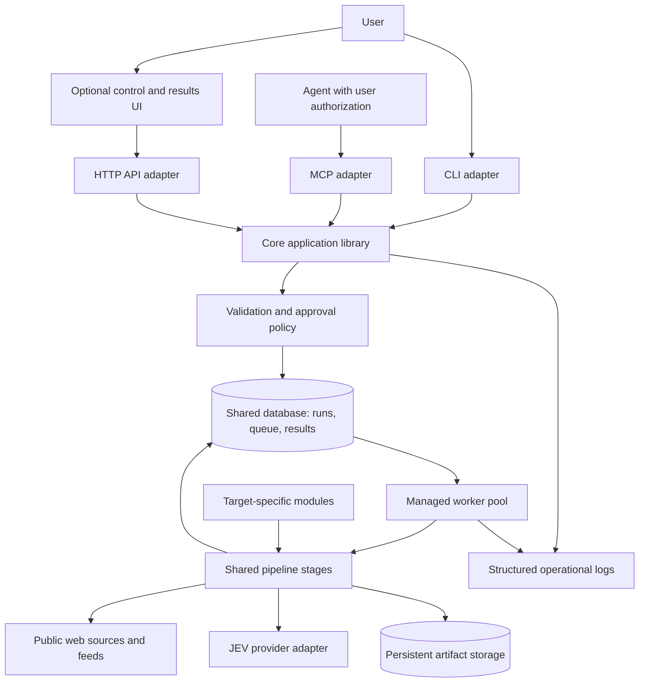
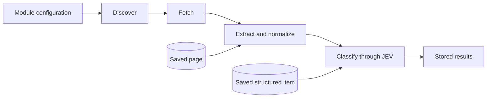
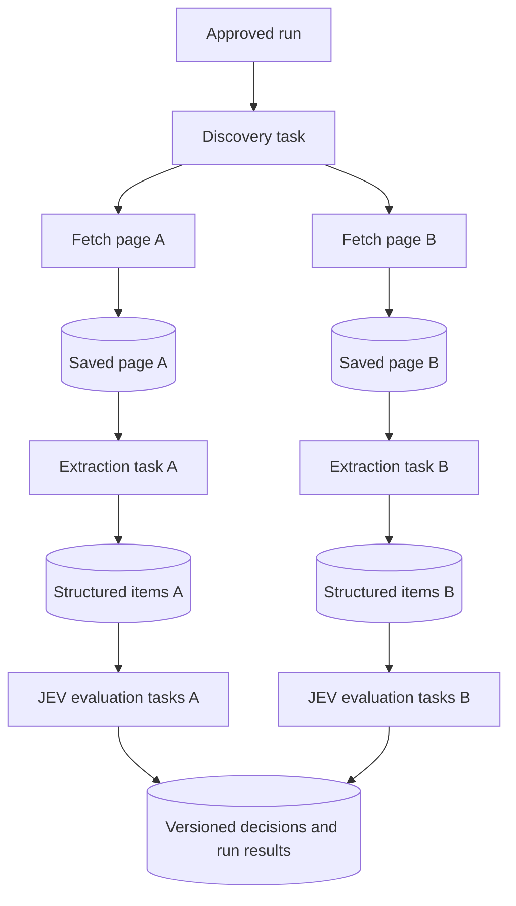
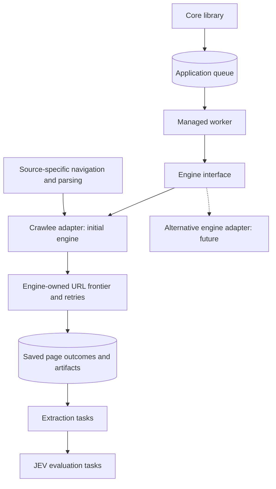
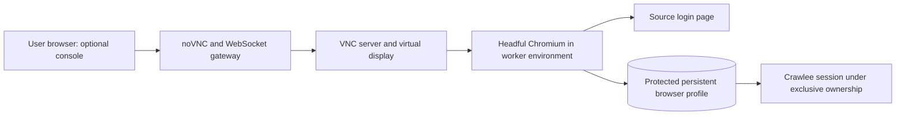
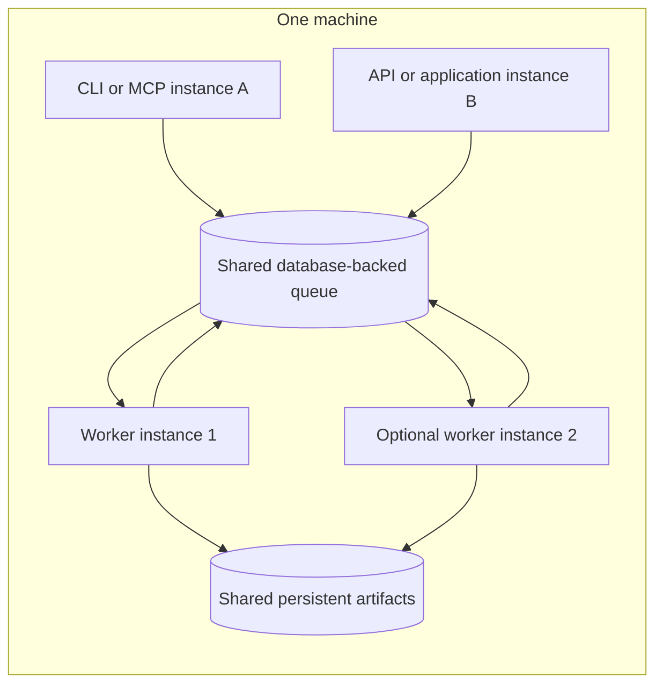
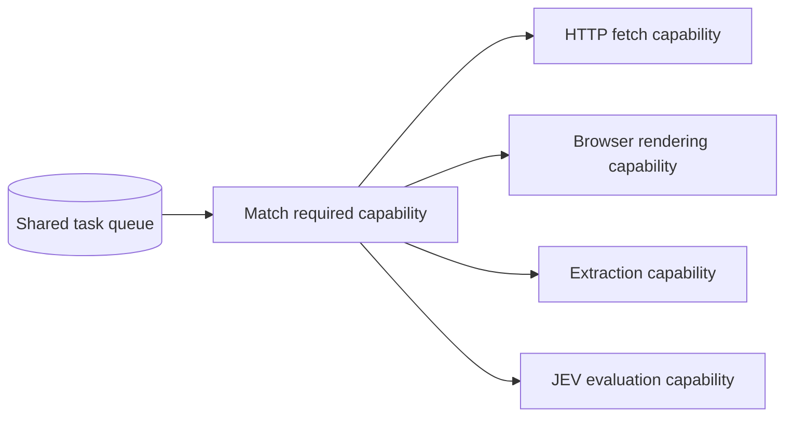
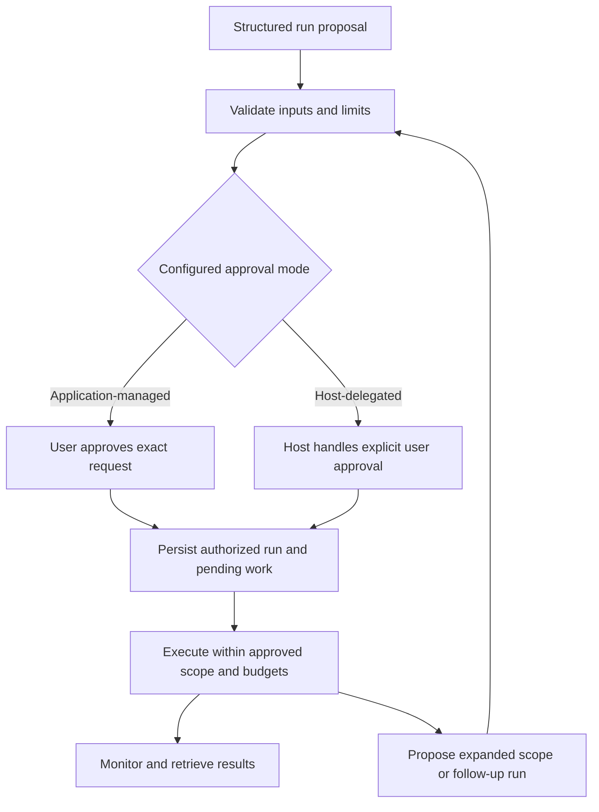
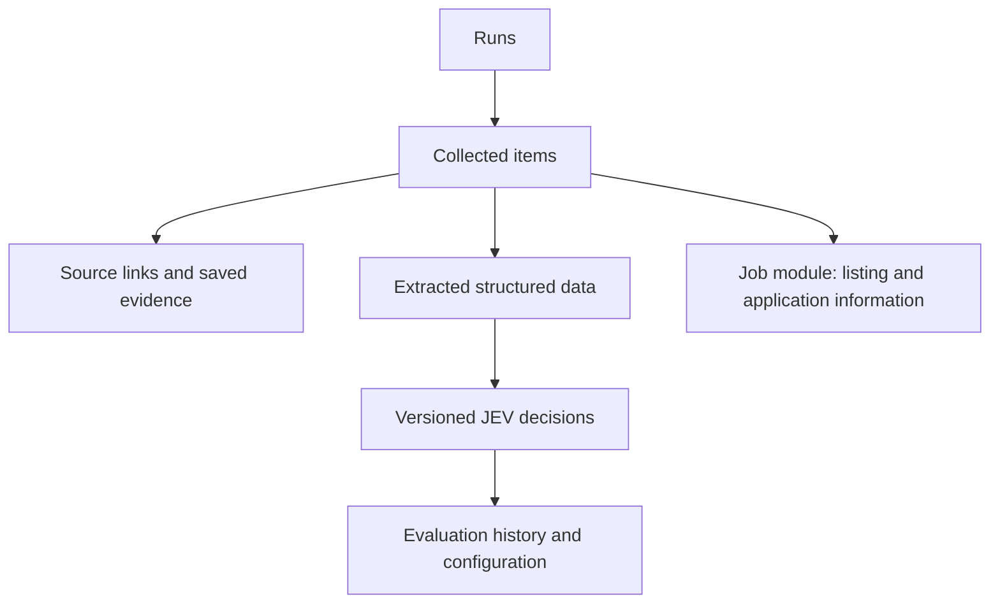

# JevScout system architecture

Status: architecture and implementation progress, October 29, 2026. Python and Crawlee for Python are selected. The initial filesystem run-record/inspection slice is being implemented; Crawlee execution and the application queue are not implemented. PostgreSQL is the intended later backend.

### Latest deployment decision: filesystem first

The user selected ordinary filesystem persistence for current hardware constraints. PostgreSQL is the intended later backend. This supersedes requiring a database/application queue in the initial implementation and the target-state diagrams below. Begin with one local execution process, atomic metadata files and saved artifacts behind a storage adapter. There is no shared file queue or multi-writer guarantee. Background workers, distributed claiming, and multi-container recovery remain target-state capabilities, deferred until a maintained queue/backend is adopted. Initial CLI submission records pending requests; it does not execute or imply approval of a crawl. Track implementation status in [Changelog](../CHANGELOG.md).

See [Complete system overview](system-overview.md) for the entire design in one graph and an end-to-end sequence diagram.

The confirmed first milestone is collection through the CLI, saved source evidence, structured extraction, and result inspection. JEV integration follows collection. Indeed/Naukri access feasibility is evaluated separately so the core can be developed against controlled fixtures without assuming target-site access.

## Purpose and deployment boundary

JevScout is a general web collection and classification system. Target-specific modules customize a common pipeline. Jobs are the first module, not a constraint on the core.

Initially, all applications run on one machine, optionally in multiple containers. Remote worker connections and remote-client authentication are deferred. Keep room for a future connection adapter without implementing remote operation now.

## Components

| Component | Responsibility |
| --- | --- |
| Core application library | Submit, validate, approve, inspect, cancel, and retrieve runs through shared application operations |
| CLI | Local commands, structured inputs, background submission, and optional waiting for results |
| MCP | Agent-callable tools using the same application operations |
| HTTP API | Application adapter used by the optional UI; shares core behavior |
| Modules | Discovery strategies, extraction schemas, classification rules, configuration and capability declarations |
| Shared pipeline | Common fetching, stage handoffs, task execution, persistence, resource enforcement, and logging |
| Workers | Claim eligible tasks and execute them within approved limits |
| Database and queue | Durable run/task state, pending work, approvals, configuration versions, and structured results |
| Artifact storage | Saved stage outputs such as permitted page content and larger documents |
| Optional UI | Approvals, run submission/progress/cancellation, and exploration of collected data and decisions |

These are code boundaries, not a requirement for separate services. Keep transport-specific behavior outside the core library. Interfaces call library functions directly where appropriate; the UI reaches those operations through HTTP. Modules do not start their own execution systems.

## Module contract and pipeline composition

Modules define domain behavior through explicit extension points. The core remains responsible for execution, validation, storage, limits, and observability. Module declarations include configuration fields, available actions, and result types so a future UI can present them through common forms and views.

Use standard stages initially. A run can collect only, extract from saved pages, or reclassify saved items. Skip upstream stages only when valid saved inputs are available, and validate their compatibility with the requested module/schema versions. A configurable arbitrary workflow graph is deferred.

Discovery can generate further collection tasks automatically within the approved source boundaries and remaining budget. Outside-scope links are recorded as candidates for a separately approved run. They do not silently expand the current crawl.

## Runs, tasks, and stage outputs

A run is one user-approved request with structured inputs: module, sources, filters, selected stages, resource limits, and any JEV configuration. A task is a smaller execution unit generated within that run. One run may contain many discovery, fetch, extraction, and classification tasks.

Persist task state and attempt history independently; aggregate progress and budget consumption at run level. Permit partial results when some tasks fail. Retry a failed stage using persisted upstream outputs rather than repeating the entire run.

Stages exchange references to persisted outputs, not whole documents embedded in queue messages. Each output records its schema/version, producing task, and provenance. Preserve the relationship between collected content, extracted items, and evaluations so results can be inspected and rerun.

Detailed record schemas and lifecycle status names are implementation decisions. The required concepts are runs, tasks/attempts, stage outputs, versioned evaluation configuration, decisions, approvals, resource usage, and provenance.

## Shared queue and worker capabilities

Use a maintained database-backed queue library rather than writing a queue engine. Choose the library after selecting the core language. PostgreSQL is the current recommendation, not a finalized product choice.

### Crawling engine ownership: updated decision

Embed Crawlee as a dependency behind a JevScout engine adapter. Reuse its integrated crawling machinery rather than assembling fetchers into a custom crawler. This supersedes interpreting every discovered URL as a separately leased application task in the earlier task diagram. Page outcomes remain individually persisted and inspectable.

The application queue owns bounded crawl-session tasks and downstream extraction/JEV tasks. Crawlee owns each session's URL frontier, duplicate-request filtering, request scheduling, browser/session lifecycle, and bounded request retries. JevScout owns approval, run lifecycle, global budgets, artifact provenance, and session-level recovery. Coordinate retry budgets across layers rather than multiplying attempts. Exact recovery and strict global accounting require an integration prototype.

### Replaceable engines in a modular application

Keep Crawlee objects/imports out of the core domain and public CLI/MCP/API contracts. Define small application-owned request, artifact, progress, error, and capability contracts. The adapter translates between these and framework-specific types. An engine registry selects a configured adapter for new crawl sessions; multiple implementations may coexist without requiring separate services.

Source integrations define navigation, pagination, recognition, and parsing. Keep pure parsing on saved HTML/data independent of Crawlee where practical. Browser interactions can be engine-specific and must declare that requirement; do not hide every possible browser operation behind an elaborate universal API.

The user's intent is change isolation: updating or replacing one component should require focused changes to that component and its adapter, not a rewrite of the application. Runtime hot-swapping, live migration, and zero-downtime replacement are not requirements. Ordinary rebuilds and restarts are acceptable. Keep contracts small and explicit, and version persisted data/configuration where compatibility matters. Engine-specific checkpoint formats are not assumed portable.

### Authentication and interactive browser access

Crawlee uses Playwright for browser-backed sessions. Support user-assisted authentication and reuse of protected browser profiles where source access permits it. Login state and crawl checkpoint state are separate persistent resources. Give each account profile an exclusive active owner; never mount one live browser profile into multiple workers concurrently. Session expiration should pause affected work for user reauthentication rather than trigger unbounded login retries.

For desktop use, open a local headful browser. For container-only use, a proposed optional browser console streams the container's headful browser into the user's web browser using a virtual display, VNC, and noVNC. This is remote display/control of a real browser, not an iframe containing the target website. noVNC is a proposed implementation, not a selected dependency yet.

During manual login, automation yields control; resume after verifying the session is ready. Expose the console only locally initially, protect access to it, and do not log credentials, cookies, or login screenshots. Container/browser setup must preserve appropriate browser isolation rather than disabling its sandbox merely for convenience. Console/profile attachment and exact pause/resume hooks remain to be tested.

Sources: [Crawlee Playwright options](https://crawlee.dev/python/api/class/PlaywrightCrawler), [Playwright authentication](https://playwright.dev/python/docs/auth), [noVNC](https://github.com/novnc/noVNC), [Playwright container guidance](https://playwright.dev/python/docs/docker).

### Initial source targets

Indeed and Naukri are the first requested source-adapter targets. This is a prioritization decision, not a claim of verified automated access or implemented support. Validate supported access methods and representative pages before promising coverage. Indeed's terms condition automated access and permitted crawling; Naukri's access terms and routes remain unverified in this research. Manual authentication does not establish automated-access permission. Keep search discovery and employer career-page collection as distinct adapters alongside board-specific integrations.

Reference: [Indeed terms](https://www.indeed.com/legal). No source collection has been implemented or exercised.

Instances share the same configured database and artifact storage. Container service names identify database endpoints on the container network; each container's localhost refers to itself. Separate applications communicate through durable records rather than process-local queues.

Workers claim eligible tasks through the queue library. Claiming, retry/recovery behavior, and crash handling must be evaluated when selecting that library. Do not assume exactly-once external effects: task handlers must tolerate duplicate attempts, and an interrupted provider request may incur a repeated charge.

Start with one worker process supporting the capabilities actually implemented. These capability labels allow specialized workers later; they do not require four services now. Start workers explicitly as part of setup. A submission adds queued work and does not spawn another worker process.

Enforce concurrency, runtime, page, and model-usage budgets across the worker pool. More worker instances must not multiply approved limits. Coordinate resource reservations and usage centrally; exact accounting mechanisms remain to be designed.

## Approval and agent behavior

Agents are clients of the same operations as human interfaces. They submit structured requests, monitor approved runs, retrieve results for further use, and may propose linked follow-up runs. Record initiator and parent-run provenance.

Approval binds to the exact structured inputs, including sources, limits, and JEV questions/rubrics/weights. Internal tasks and observation of the authorized run proceed without repeated approval prompts. Expanded scope and follow-up work require fresh approval.

Application-managed approval is enforced by the application, with a trusted user interaction still to be designed. Host-delegated approval allows operation without a dedicated approval UI; it relies on the calling host's user-approval controls. It is a trust boundary, not independent proof that a user approved a request.

Approval mode is deployment configuration, not a field an agent can override in a run. An agent may change that configuration only through a separately and explicitly user-approved action. An approval override never disables resource limits. Arbitrary process creation is not a module or agent capability.

## JEV boundary

JEV makes focused typed decisions. Application code owns scheduling, crawling, retries, composition, and storage. Agents may propose JEV configuration as part of the approved request; validate and version it.

Store model identity, question/rubric versions, input/output provenance, and application-defined weights alongside evaluations. Jev returns Choice, Score, and Noul outputs; it does not generate free-text explanations. Build summaries from dimension results, predefined descriptions, and extracted evidence. The job module can show application details beside fit decisions without embedding job concepts into the core.

Provider details are documented in [JEV integration research](jev-integration.md). Live API validation is pending.

## Results explorer and persistence

The explorer is a view of application records and their relationships, not unrestricted filesystem browsing. UI implementation is deferred; shared operations should expose enough provenance and outputs for CLI/MCP access first and UI growth later.

Database and artifacts survive container replacement through persistent storage. Raw-content retention, deletion behavior, and schema details remain open; keep credentials and private inputs out of routine logs and version control.

## Visibility and debugging

Add structured logs at submission, validation/approval, task claiming, stage transitions, retries, provider calls, cancellation, budget exhaustion, failures, and completion. Correlate records by run, task, stage, and attempt identifiers where applicable. Provide opt-in debug logs for diagnosis. Exclude credentials, private profile contents, and whole page bodies from routine logs.

Persist task status and attempt history for inspection after restarts. Durable events for a future UI and the logging/metrics tooling are recommendations to evaluate, not selected technologies.

## Deferred decisions

- Database product, Python application queue library, dependency versions, and packaging details.
- Exact module interfaces, record schemas, validation contracts, and compatibility rules.
- Queue recovery, cancellation, shutdown, duplicate-attempt handling, and shared-budget implementation.
- Trusted approval interaction and host-delegated integration details.
- Artifact retention/deletion policies and detailed UI implementation.
- Remote connections/authentication, arbitrary workflow graphs, and specialized worker deployments.
- Indeed/Naukri access feasibility and adapter details; user preferences and scoring weights remain deferred.
- Optional interactive browser console implementation and integration with session ownership and pause/resume.
