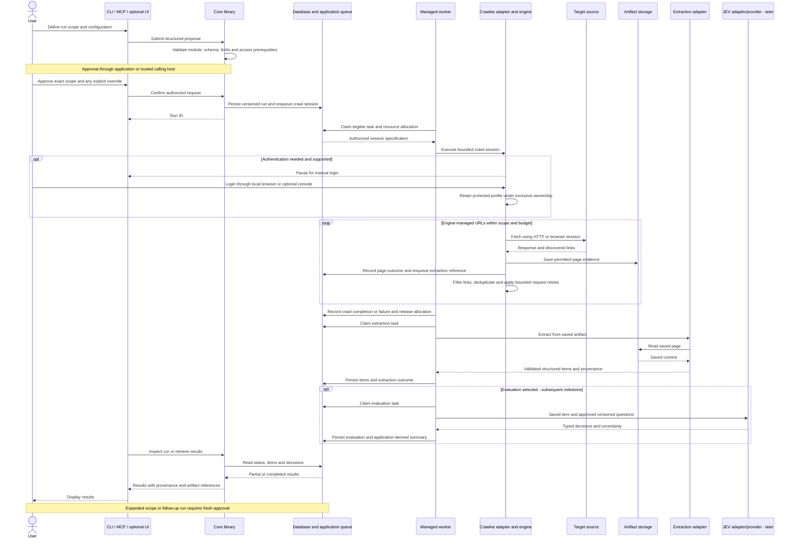

# Complete system overview

Implementation update: the first low-resource backend uses local filesystem records and artifacts with a single process. Database-backed queues and multi-container workers in these diagrams are the later target architecture. PostgreSQL is deferred; no custom shared file queue is planned. See [Changelog](../CHANGELOG.md).

This is the target architecture, not a claim that components are implemented. Python, Crawlee, the collection-first milestone, and separate target-source feasibility checks are confirmed. Filesystem persistence comes first; PostgreSQL and an application queue come later. All application components initially run on one machine; subgraphs are module boundaries, not mandatory microservices or containers.

## Entire system in one graph

Solid arrows show calls or data movement; dotted arrows show configuration, policy, or optional/future extensions. The first milestone follows CLI → core → queued crawl → saved artifacts → extraction → inspection. JEV, MCP, HTTP/UI, and the browser console are subsequent increments.

```mermaid
flowchart TB
    User[User]
    Agent[Agent acting with user authorization]

    subgraph Machine[One machine - modular Python application - containerizable]
        subgraph Interfaces[Thin interface adapters]
            CLI[CLI: submit, wait, inspect, cancel]
            MCP[MCP: agent tools]
            API[HTTP API]
            UI[Optional UI: control and results explorer]
            Console[Optional interactive browser console]
        end

        subgraph Core[Core application library - no Crawlee types in public contracts]
            Commands[Submit, approve, inspect, cancel, retrieve]
            Validate[Validate structured inputs and schema compatibility]
            Mode{Deployment approval mode}
            AppApproval[Application-managed user approval]
            HostApproval[Host-delegated user approval]
            Spec[Authorized versioned run specification]
            Config[Deployment configuration and engine registry]
            Control[Run lifecycle and cancellation]
            Limits[Shared limits: concurrency, pages, time, model usage]
            Query[Read status, artifacts and decisions]
        end

        subgraph Modules[Target modules and source-specific adapters]
            Job[Job module: configuration and result schema]
            Indeed[Indeed: target adapter - access unverified]
            Naukri[Naukri: target adapter - access unverified]
            Career[Employer career-page and ATS adapters]
            Search[Search-provider discovery adapter]
            SourceRules[Seeds, scope, navigation, pagination, parsing]
            FutureModule[Future domain modules]
        end

        subgraph Execution[Durable application execution]
            Queue[(Maintained database-backed application queue)]
            Workers[Explicitly started bounded worker pool]
            Eligible[Claim task matching worker capabilities]
            CrawlTask[Bounded crawl-session task]
            ExtractTask[Extraction task from saved page]
            EvalTask[Evaluation task from saved item - later]
            Attempts[Attempt history, bounded retries and recovery]
        end

        subgraph Collection[Replaceable crawling integration]
            Port[Application-owned engine interface]
            Crawlee[Crawlee adapter - selected initial engine]
            Other[Alternative engine adapters - future]
            Frontier[Crawlee URL frontier, deduplication and request retries]
            Fetch[HTTP or Playwright browser fetching]
            Sessions[Session, cookie and configured proxy management]
            Scope{Discovered URL within scope and budget?}
            Candidate[Outside-scope candidate for separately approved work]
            PageOutcome[Per-page outcome, links and evidence references]
        end

        subgraph Authentication[User-assisted authentication]
            Manual[Manual login - automation yields control]
            Display[Virtual display and VNC/noVNC - proposed]
            Browser[Headful browser]
            Profile[(Protected account-scoped browser profile)]
            Lease[Exclusive profile ownership]
            Expiry[Expired login: pause and request user action]
        end

        subgraph Processing[Extraction and typed decisions]
            Parse[Source-specific parsing and normalization]
            Items[Validated versioned structured items]
            JevAdapter[JEV provider adapter]
            Rubric[Approved questions, rubrics and configuration versions]
            Decision[Validated typed decisions and uncertainty]
            Compose[Application weights and evidence-based summaries]
        end

        subgraph Persistence[Durable shared storage]
            DB[(Database: runs, tasks, approvals, usage, provenance)]
            Artifacts[(Artifacts: saved pages and stage outputs)]
            Results[(Structured items and evaluation history)]
        end

        subgraph Visibility[Inspection and debugging]
            Logs[Structured logs and opt-in debug logs - redacted]
            Progress[Run progress and partial results]
        end
    end

    subgraph External[External systems]
        Web[Authorized source pages, APIs and feeds]
        SearchAPI[Selected search provider - undecided]
        JevAPI[TypeSafe JEV API - live validation pending]
    end

    User --> CLI
    User --> UI
    Agent --> MCP
    Agent --> CLI
    UI --> API
    CLI --> Commands
    MCP --> Commands
    API --> Commands
    Commands --> Validate
    Validate --> Mode
    Config -.-> Mode
    Mode --> AppApproval
    Mode --> HostApproval
    User --> AppApproval
    User --> HostApproval
    AppApproval --> Spec
    HostApproval --> Spec
    Spec --> DB
    Spec --> Queue
    Commands --> Control
    Commands --> Query
    Control --> DB
    Control -.-> Workers
    Spec -.-> Limits
    Limits <--> DB
    Job --> Indeed
    Job --> Naukri
    Job --> Career
    Job --> Search
    Indeed --> SourceRules
    Naukri --> SourceRules
    Career --> SourceRules
    Search --> SearchAPI
    SearchAPI --> SourceRules
    FutureModule -.-> SourceRules
    SourceRules -.-> Validate
    SourceRules -.-> Crawlee
    SourceRules -.-> Parse
    Queue --> Workers
    Workers --> Eligible
    Limits -.-> Eligible
    Eligible --> CrawlTask
    Eligible --> ExtractTask
    Eligible --> EvalTask
    Attempts <--> DB
    Workers --> Attempts
    CrawlTask --> Port
    Config -.-> Port
    Port --> Crawlee
    Port -.-> Other
    Crawlee --> Frontier
    Frontier --> Fetch
    Sessions --> Fetch
    Fetch <--> Web
    Fetch --> PageOutcome
    PageOutcome --> Scope
    Limits -.-> Scope
    Scope -->|Yes: engine-owned next request| Frontier
    Scope -->|No| Candidate
    Candidate --> DB
    PageOutcome --> Artifacts
    PageOutcome --> DB
    PageOutcome -->|Schedule downstream task with artifact reference| Queue
    ExtractTask --> Parse
    Artifacts --> Parse
    Parse --> Items
    Items --> Results
    Items -->|Optional evaluation task| Queue
    EvalTask --> JevAdapter
    Results --> JevAdapter
    Spec -.-> Rubric
    Rubric --> JevAdapter
    JevAdapter <--> JevAPI
    JevAdapter --> Decision
    Decision --> Compose
    Compose --> Results
    User --> Console
    Console --> Display
    Display --> Browser
    Browser --> Manual
    Manual <--> Web
    Browser --> Profile
    Lease -.-> Browser
    Lease -.-> Sessions
    Profile --> Sessions
    Sessions --> Expiry
    Expiry --> Progress
    Expiry -.-> Manual
    Core -.-> Logs
    Workers --> Logs
    Crawlee --> Logs
    DB --> Progress
    Query --> DB
    Query --> Artifacts
    Query --> Results
    Query --> Progress
    Progress --> CLI
    Progress --> MCP
    Progress --> API
```

## End-to-end interaction sequence

Entities have vertical lifelines; calls, data, and responses travel between them. Independent extraction or evaluation reruns can start from compatible saved outputs without crawling again.

## Reading boundaries correctly

- The shared application queue schedules crawl sessions, extraction, and evaluation. Crawlee's frontier schedules URLs inside a session; they do not compete to own page retries.
- Profile and engine state have exclusive ownership where required; multiple workers must not concurrently use one live browser profile or unsafe filesystem queue.
- Source adapters are targets, not claims of working access. Indeed and Naukri still need feasibility validation independently of the core prototype.
- The profile, worker, console, and processing boxes may be modules/processes in one deployment. They are not a prescription for a service per box.
- Engine replacements are ordinary scoped code changes behind explicit contracts. Live migration and runtime hot-swapping are not requirements.
- The sequence is conceptual. Concrete operation names, transactions, authentication UX, cancellation semantics, and budgets still need implementation design.

See [System architecture](system-architecture.md) for detailed responsibilities and open decisions, and [Architecture decisions](architecture-decisions.md) for the decision record.
